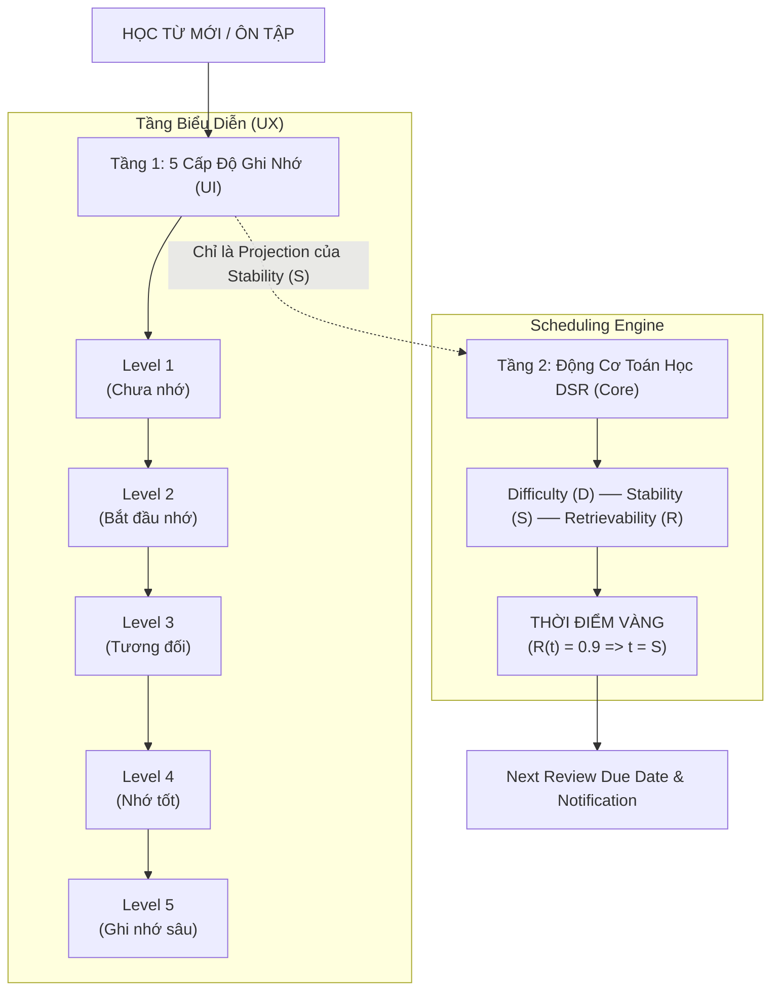

# Tài Liệu Kỹ Thuật: Thuật Toán Học Ngắt Quãng & Thời Điểm Vàng (Spaced Repetition & Golden Time Engine)

Tài liệu này quy định kiến trúc và mã nguồn triển khai thuật toán Spaced Repetition cho ứng dụng **LinguaFlow**. Hệ thống tách biệt rõ ràng giữa tầng biểu diễn giao diện và động cơ tính toán toán học:

1. **Presentation Layer (Tầng Biểu Diễn - UX):** Phân loại từ vựng thành **5 Cấp độ Ghi nhớ (Levels 1 - 5)** giúp người học dễ hình dung tiến trình tích lũy trí nhớ.
2. **Scheduling Engine (Tầng Toán Học - DSR):** Sử dụng mô hình độ bền trí nhớ ($S$) và xác suất nhớ lại ($R$) để tính toán chính xác **Thời điểm vàng (Golden Time)** cho từng từ vựng dựa trên lịch sử tương tác.

---

## 1. Bản Chất Kiến Trúc 2 Tầng (Dual-Layer Architecture)



### Điểm mấu chốt:

- **5 Cấp độ không phải là khoảng cách cố định:** Không gán cứng kiểu `Level 1 = 1 ngày`, `Level 2 = 3 ngày` (vì mỗi người có tốc độ phản xạ khác nhau và mỗi từ có độ khó khác nhau).
- **Cấp độ là hàm ánh xạ từ Stability ($S$):** $Level = f(S)$. Stability ($S$) là khoảng thời gian (tính bằng ngày) mà sau đó Retrievability ($R$) dự kiến giảm xuống mức mục tiêu $r_{\text{target}} = 0.9$ ($90\%$). Đây là tham số dự đoán của mô hình. Khi $S$ tăng qua các lần ôn đúng, cấp độ trực quan trên UI sẽ tự động tăng theo.

---

## 2. Quy Tắc Ánh Xạ 5 Cấp Độ Ghi Nhớ (LinguaFlow Proposed Mapping)

Hệ thống phân loại thẻ vào 5 cấp độ dựa trên chỉ số Stability ($S$ - tính bằng ngày) được tính toán từ động cơ DSR:

| Cấp Độ (UI Level) | Tên Gọi Trạng Thái | Điều Kiện Stability ($S$) | Tần Suất Ôn Tập Tương Ứng | Hành Vi Khi Quên (Lapse) |
| :--- | :--- | :--- | :--- | :--- |
| **Level 1** | Mới học / Chưa nhớ | $S < 2.0$ ngày | Rất thường xuyên (vài giờ đến 1 ngày) | Tính lại $S_{\text{new}}$, ánh xạ lại Level từ $S_{\text{new}}$ |
| **Level 2** | Bắt đầu nhớ | $2.0 \le S < 5.0$ ngày | Thường xuyên (2 – 4 ngày) | Tính lại $S_{\text{new}}$, ánh xạ lại Level từ $S_{\text{new}}$ |
| **Level 3** | Nhớ tương đối | $5.0 \le S < 14.0$ ngày | Giãn cách vừa (5 – 13 ngày) | Tính lại $S_{\text{new}}$, ánh xạ lại Level từ $S_{\text{new}}$ |
| **Level 4** | Nhớ tốt | $14.0 \le S < 45.0$ ngày | Khá thưa (khoảng 2 tuần – 1.5 tháng) | Tính lại $S_{\text{new}}$, ánh xạ lại Level từ $S_{\text{new}}$ |
| **Level 5** | Ghi nhớ sâu | $S \ge 45.0$ ngày | Rất thưa (trên 1.5 tháng – vài tháng) | Tính lại $S_{\text{new}}$, ánh xạ lại Level từ $S_{\text{new}}$ |

> **Lưu ý:** Các ngưỡng $2.0, 5.0, 14.0, 45.0$ ngày là thông số ánh xạ UI do LinguaFlow đề xuất. Cấp độ UI hoàn toàn là kết quả chiếu (projection) từ chỉ số $S$ và không tác động ngược lại mô hình tính toán DSR.

---

## 3. Công Thức Tính "Thời Điểm Vàng" (Golden Time Calculation)

Hệ thống mô hình hóa khả năng hồi tưởng (Retrievability) theo thời gian $t$ (tính bằng ngày) trôi qua kể từ lần ôn trước:

$$R(t) = 0.9^{\frac{t}{S}} = e^{\frac{t \cdot \ln(0.9)}{S}}$$

- **$t$ (Elapsed Time):** Thời gian thực tế trôi qua kể từ lần review gần nhất (tính bằng ngày).
- **$S$ (Memory Stability):** Khoảng thời gian (ngày) để xác suất nhớ lại giảm về mức $r_{\text{target}} = 0.9$ ($90\%$).
- **$R(t)$ (Retrievability):** Xác suất dự đoán người học nhớ lại được từ vựng tại thời điểm $t$.

Tại thời điểm $t = S$:
$$R(S) = 0.9^{\frac{S}{S}} = 0.9 \quad (90\%)$$

### Định nghĩa "Thời điểm vàng":
Thời điểm vàng $t_{\text{golden}}$ là khoảng thời gian giãn cách tới lần ôn tập tiếp theo sao cho Retrievability chạm ngưỡng mục tiêu $r_{\text{target}} = 0.9$:

$$r_{\text{target}} = 0.9^{\frac{I_{\text{golden}}}{S}} \implies I_{\text{golden}} = S \cdot \frac{\ln(r_{\text{target}})}{\ln(0.9)} = S \quad (\text{khi } r_{\text{target}} = 0.9)$$

- **Ngưỡng 90% Target Retention:** LinguaFlow chọn $90\%$ làm retention mục tiêu để tối ưu hóa giữa tỷ lệ ghi nhớ dài hạn và khối lượng bài tập ôn hàng ngày.
- **Ôn trước thời điểm vàng ($R > 95\%$):** Quá sớm, lãng phí thời gian, hiệu quả nỗ lực hồi tưởng (*Desirable Difficulty*) không cao.
- **Ôn sau thời điểm vàng ($R < 90\%$):** Khi $R$ giảm thấp hơn target $0.9$, người học đã vượt quá khoảng thời gian review được đề xuất; khoảng cách $t$ càng dài thì xác suất dự đoán nhớ lại $R(t)$ càng giảm.
- **Ôn đúng thời điểm vàng ($R \approx 90\%$):** Thời điểm thích hợp để củng cố dấu vết trí nhớ trước khi từ vựng bị quên.

---

## 4. Cơ Sở Dữ Liệu (PostgreSQL / Supabase Schema)

```sql
-- 1. Bảng lưu trữ trạng thái hiện tại của từng từ vựng
CREATE TABLE IF NOT EXISTS card_memory_state (
  card_id UUID PRIMARY KEY REFERENCES cards(id) ON DELETE CASCADE,
  user_id UUID NOT NULL,

  -- Thuộc tính trực quan (Presentation)
  memory_level INT NOT NULL DEFAULT 1 CHECK (memory_level BETWEEN 1 AND 5),

  -- Thuộc tính toán học DSR (Scheduling Engine)
  difficulty FLOAT NOT NULL DEFAULT 5.0,  -- Thang 1.0 (rất dễ) đến 10.0 (rất khó)
  stability FLOAT NOT NULL DEFAULT 0.5,   -- Số ngày dự kiến duy trì R >= 90%

  -- Lịch sử tổng quan
  reps INT NOT NULL DEFAULT 0,            -- Tổng số lần trả lời đúng liên tiếp
  lapses INT NOT NULL DEFAULT 0,          -- Số lần bị quên/trả lời sai
  last_reviewed TIMESTAMPTZ,              -- Thời điểm ôn tập gần nhất
  golden_time TIMESTAMPTZ NOT NULL,       -- "Thời điểm vàng" cần ôn kế tiếp (due date)

  created_at TIMESTAMPTZ DEFAULT NOW()
);

-- Index phục vụ query "Các từ đã đến thời điểm vàng cần ôn hôm nay"
CREATE INDEX IF NOT EXISTS idx_golden_time ON card_memory_state(user_id, golden_time ASC);

-- 2. Bảng lưu lịch sử chi tiết từng lượt review (Phục vụ Calibration & Analytics)
CREATE TABLE IF NOT EXISTS card_review_history (
  id UUID PRIMARY KEY DEFAULT gen_random_uuid(),
  card_id UUID NOT NULL REFERENCES cards(id) ON DELETE CASCADE,
  user_id UUID NOT NULL,

  rating INT NOT NULL CHECK (rating BETWEEN 1 AND 4), -- 1: Again, 2: Hard, 3: Good, 4: Easy
  reviewed_at TIMESTAMPTZ NOT NULL DEFAULT NOW(),

  elapsed_days FLOAT NOT NULL,             -- Số ngày thực tế trôi qua từ lần ôn trước
  retrievability FLOAT NOT NULL,           -- R tại thời điểm ôn

  old_difficulty FLOAT NOT NULL,
  new_difficulty FLOAT NOT NULL,

  old_stability FLOAT NOT NULL,
  new_stability FLOAT NOT NULL,

  created_at TIMESTAMPTZ DEFAULT NOW()
);

CREATE INDEX IF NOT EXISTS idx_review_history_user ON card_review_history(user_id, card_id);
```

---

## 5. Mã Nguồn Hiện Thực Thuật Toán (TypeScript Engine)

Tạo file `lib/golden-time-engine.ts`:

```typescript
export type ReviewRating = 1 | 2 | 3 | 4;
// 1: Again (Quên) | 2: Hard (Nhớ khó khăn) | 3: Good (Nhớ tốt) | 4: Easy (Nhớ ngay lập tức)

export interface MemoryState {
  memoryLevel: number; // 1 -> 5
  difficulty: number;  // 1.0 -> 10.0
  stability: number;   // Ngày (Interval cho R = 0.9)
  reps: number;
  lapses: number;
  lastReviewed: Date | null;
  goldenTime: Date;    // Timestamp thời điểm vàng tiếp theo
}

export class GoldenTimeEngine {
  public static readonly TARGET_RETENTION = 0.9; // Mục tiêu giữ 90% khả năng nhớ
  private static readonly MAX_STABILITY_MULTIPLIER = 2.5; // Giới hạn tốc độ tăng Stability tránh bùng nổ quá nhanh

  /**
   * Ánh xạ từ chỉ số Stability sang 5 Memory Levels trên UI
   */
  static calculateMemoryLevel(stability: number): number {
    if (stability < 2.0) return 1;
    if (stability < 5.0) return 2;
    if (stability < 14.0) return 3;
    if (stability < 45.0) return 4;
    return 5;
  }

  /**
   * Tính xác suất nhớ lại (Retrievability R) chính xác theo công thức R(t) = 0.9^(t/S)
   */
  static calculateRetrievability(stability: number, elapsedDays: number): number {
    if (stability <= 0) return 0;
    return Math.pow(this.TARGET_RETENTION, elapsedDays / stability);
  }

  /**
   * Tính khoảng cách ngày đến "Thời điểm vàng" kế tiếp (với target = 0.9 thì Interval = S)
   */
  static getNextGoldenInterval(stability: number): number {
    const intervalDays = Math.max(
      0.1, // Tối thiểu ~2.4 giờ cho từ rất khó hoặc mới hỏng
      stability * (Math.log(this.TARGET_RETENTION) / Math.log(0.9))
    );
    return intervalDays;
  }

  /**
   * Khởi tạo trạng thái cho từ vựng mới học
   */
  static initNewWord(rating: ReviewRating): MemoryState {
    const initD: Record<ReviewRating, number> = { 1: 8.0, 2: 6.0, 3: 4.5, 4: 2.5 };
    const initS: Record<ReviewRating, number> = { 1: 0.3, 2: 1.0, 3: 2.5, 4: 5.0 };

    const difficulty = initD[rating];
    const stability = initS[rating];
    const intervalDays = this.getNextGoldenInterval(stability);

    const now = new Date();
    const goldenTime = new Date(now.getTime() + intervalDays * 24 * 60 * 60 * 1000);

    return {
      memoryLevel: this.calculateMemoryLevel(stability),
      difficulty,
      stability,
      reps: rating === 1 ? 0 : 1,
      lapses: rating === 1 ? 1 : 0,
      lastReviewed: now,
      goldenTime,
    };
  }

  /**
   * Cập nhật trạng thái DSR sau mỗi lần Review
   */
  static processReview(current: MemoryState, rating: ReviewRating): MemoryState {
    const now = new Date();
    const last = current.lastReviewed ? new Date(current.lastReviewed) : now;
    const elapsedDays = Math.max(0, (now.getTime() - last.getTime()) / (1000 * 60 * 60 * 24));

    const retrievability = this.calculateRetrievability(current.stability, elapsedDays);

    let newD = current.difficulty;
    let newS = current.stability;
    let lapses = current.lapses;
    let reps = current.reps;

    if (rating === 1) {
      // 1. NGƯỜI DÙNG QUÊN (FAIL / AGAIN)
      // Tăng độ khó vừa phải, giảm Stability theo tỷ lệ (lapse factor ~0.3)
      newD = Math.min(10.0, current.difficulty + 1.5);
      newS = Math.max(0.3, current.stability * 0.3);
      lapses += 1;
      reps = 0;
    } else {
      // 2. NGƯỜI DÙNG NHỚ ĐƯỢC (PASS / HARD / GOOD / EASY)
      const diffD: Record<ReviewRating, number> = { 1: 0, 2: 0.4, 3: -0.2, 4: -0.6 };
      newD = Math.max(1.0, Math.min(10.0, current.difficulty + diffD[rating]));

      // Tăng độ bền Stability: 
      // Kết hợp giữa hệ số độ khó (Difficulty Factor) và điểm thưởng khi nhớ lại ở Retrievability thấp (Retrieval Bonus)
      const difficultyFactor = (11 - newD) / 5;
      const retrievalBonus = Math.min(1.2, Math.pow(1 - retrievability, 0.5) * 1.2);
      
      const baseMultiplier = 1 + (difficultyFactor * 0.4) + retrievalBonus;
      const goodMultiplier = Math.min(this.MAX_STABILITY_MULTIPLIER, baseMultiplier);
      const easyMultiplier = Math.min(this.MAX_STABILITY_MULTIPLIER, baseMultiplier * 1.25);

      if (rating === 2) {
        // Hard: Tăng nhẹ (1.2x)
        newS = current.stability * 1.2;
      } else if (rating === 3) {
        // Good: Tăng theo multiplier chuẩn đã cap
        newS = current.stability * goodMultiplier;
      } else if (rating === 4) {
        // Easy: Tăng theo easy multiplier đã cap
        newS = current.stability * easyMultiplier;
      }

      reps += 1;
    }

    const intervalDays = this.getNextGoldenInterval(newS);
    const goldenTime = new Date(now.getTime() + intervalDays * 24 * 60 * 60 * 1000);

    return {
      memoryLevel: this.calculateMemoryLevel(newS),
      difficulty: Number(newD.toFixed(2)),
      stability: Number(newS.toFixed(2)),
      reps,
      lapses,
      lastReviewed: now,
      goldenTime,
    };
  }
}
```

> **Lưu ý về thông số Heuristic & Calibration:**  
> LinguaFlow khởi tạo các tham số DSR ($0.3, 1.2, 0.4, 1.25, 2.5$) dựa trên các giá trị heuristic thực nghiệm ban đầu (*empirically chosen heuristic values*). Hệ thống tự động ghi lại toàn bộ lịch sử tương tác và trạng thái mô hình vào bảng `card_review_history` để phục vụ công tác căn chỉnh (parameter calibration) dựa trên dữ liệu học tập thực tế từ người dùng.

---

## 6. Phân Biệt Giữa "Hàng Đợi Nội Bộ" (Intra-batch) & "Thời Điểm Vàng"

Để tránh làm sai lệch việc tính toán đường cong quên dài hạn:

- **Trong một phiên học (Batch 12 từ):**
  - Nếu chọn **Again** (Level 1) hoặc gõ sai: Từ đó lặp lại sau một số lượt trong phiên. Đây là trí nhớ làm việc tạm thời (*Working Memory*).
  - **Chỉ lấy kết quả của LẦN TRẢ LỜI ĐẦU TIÊN trong phiên** để tính toán lại Stability ($S$) và chốt Thời điểm vàng (`golden_time`).
  - Các lần trả lời đúng sau đó trong cùng phiên chỉ để phục vụ hoàn thành phiên học, không được gọi hàm `processReview` lần thứ hai.
- **Xử lý Ôn trước / Ôn trễ hạn (Early / Late Review):**
  - Biến `elapsedDays` sử dụng thời gian thực tế `now - lastReviewed`. Nhờ vậy, nếu người dùng ôn muộn (Late Review khi $R < 0.9$) mà vẫn nhớ được, hệ thống sẽ tự động ghi nhận `retrievalBonus` cao hơn để tăng $S$ tương ứng.

---

## 7. Giao Diện Người Dùng (UI Representation)

Người học không cần thấy các con số toán học như $D = 4.5$ hay $S = 12.4$, mà chỉ thấy:

```text
+-------------------------------------------------------+
|  Từ: substantial /səbˈstæn.ʃəl/                       |
|  Nghĩa: Đáng kể, quan trọng                           |
+-------------------------------------------------------+
|  CẤP ĐỘ GHI NHỚ:                                      |
|  [ Level 1 ] [ Level 2 ] [ ★ Level 3 ] [ 4 ] [ 5 ]    |
|  (Nhớ tương đối - Cần củng cố thêm)                   |
+-------------------------------------------------------+
|  ⏰ Thời điểm vàng tiếp theo:                         |
|  Khoảng 8 ngày nữa (Thứ Ba, 06 Tháng 10)              |
+-------------------------------------------------------+
```

Khi đến `golden_time`, từ vựng sẽ tự động rơi vào danh sách **"Từ cần ôn tập hôm nay"** trên Dashboard của ứng dụng.
