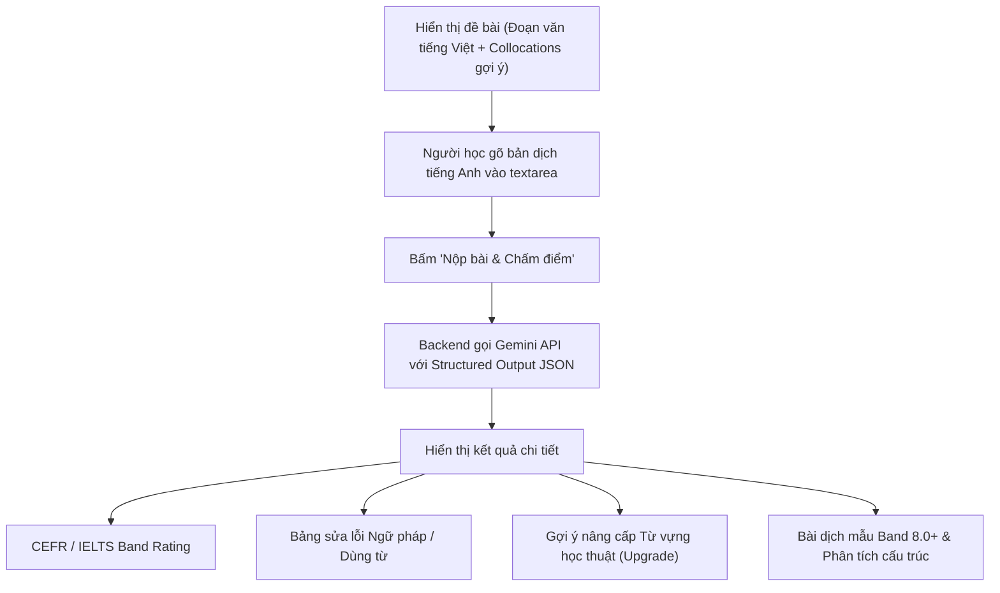

# Technical Specification: IELTS Paragraph Translation & AI Grammar Evaluation System

Tài liệu này mô tả toàn bộ kiến trúc và hướng dẫn triển khai tính năng **Luyện Dịch Đoạn Văn** (Vietnamese $\rightarrow$ English) kết hợp **Chấm điểm ngữ pháp / Phản hồi chi tiết bằng AI** và cung cấp **Bài mẫu band cao (Model Essay / Paragraph)**. Hệ thống được thiết kế theo ma trận chủ đề phân tầng từ quen thuộc đời sống đến học thuật chuyên sâu (Academic Writing - IELTS Writing Task 1 & Task 2).

---

## 1. Luồng Hoạt Động & Trải Nghiệm Người Học (Workflow)



1. **Hiển thị đề bài**: Hệ thống đưa ra một đoạn văn tiếng Việt (3–5 câu) theo chủ đề chỉ định, kèm theo thông tin ngữ cảnh, từ khóa gợi ý (IELTS collocations) và cấu trúc ngữ pháp mục tiêu.
2. **Người học làm bài**: Người học dịch toàn bộ đoạn văn sang tiếng Anh trong một khung soạn thảo (textarea).
3. **Phân tích & Chấm điểm (Grammar & Coherence Evaluation)**:
   - Người học bấm **"Nộp bài & Chấm điểm"**.
   - Hệ thống gọi backend API sử dụng Gemini API (với Structured Output JSON) để phân tích trực tiếp bài làm của người học.
4. **Hiển thị kết quả**:
   - **Điểm ngữ pháp & Từ vựng**: Nhận xét tổng quan, ước lượng trình độ CEFR / IELTS Band Score (B1, B2, C1, C2).
   - **Bảng sửa lỗi (Detailed Corrections)**: Trích xuất các lỗi ngữ pháp, dùng từ sai (word choice), giới từ hoặc trật tự từ cùng gợi ý sửa tương ứng.
   - **Gợi ý Nâng cấp Từ vựng (Academic Upgrades)**: Chỉ ra các cụm từ trong bài làm có thể nâng cấp lên IELTS Collocations học thuật tự nhiên hơn.
   - **Bài mẫu tham khảo chuẩn học thuật (Model Paragraph)**: Bản dịch hoàn chỉnh band 7.5+ sử dụng từ vựng nâng cao, liên từ tự nhiên và cấu trúc đa dạng.

---

## 2. Ma Trận Chủ Đề Định Hướng IELTS (Thematic Syllabus Matrix)

Hệ thống xoay vòng qua 6 nhóm chủ đề từ quen thuộc đến học thuật:

| Cấp độ                 | Nhóm chủ đề (Theme)               | Văn cảnh bài tập                                                                        | Trọng tâm ngữ pháp & Từ vựng IELTS                                                                                                   |
| :--------------------- | :-------------------------------- | :-------------------------------------------------------------------------------------- | :----------------------------------------------------------------------------------------------------------------------------------- |
| **Foundation (B1–B2)** | Daily Life & Personal Experiences | Thói quen sinh hoạt, đời sống sinh viên, sở thích, du lịch trải nghiệm.                 | Thì quá khứ/hoàn thành, danh động từ, mệnh đề thời gian, so sánh kép.                                                                |
| **Intermediate (B2)**  | Work, Career & Modern Society     | Làm việc từ xa, cân bằng công việc - cuộc sống, áp lực đô thị hóa, an sinh xã hội.      | Câu điều kiện (Type 2/3/Mixed), động từ khuyết thiếu thể hiện sắc thái (modals of deduction), liên từ tương phản (_whereas, while_). |
| **Academic I (B2–C1)** | Education & Technology            | Tác động của AI trong giáo dục, chuyển đổi số, mạng xã hội và sức khỏe tâm thần.        | Câu bị động khách quan (_It is argued that..._), mệnh đề quan hệ rút gọn, danh từ hóa (nominalization).                              |
| **Academic II (C1)**   | Environment & Global Issues       | Biến đổi khí hậu, năng lượng tái tạo, ô nhiễm rác thải nhựa, đa dạng sinh học.          | Mệnh đề phân từ (participle clauses), cấu trúc đảo ngữ (_Not only... but also_, _Rarely_), từ nối chỉ nguyên nhân - hệ quả.          |
| **IELTS Task 1 Focus** | Data & Trend Descriptions         | Mô tả xu hướng biểu đồ, tỷ lệ phần trăm, biến động nhân khẩu học và quy trình sản xuất. | Lối viết mô tả xu hướng (_witness a dramatic surge_, _fluctuate slightly_), cấu trúc so sánh học thuật.                              |
| **IELTS Task 2 Focus** | Culture, Art & Philosophy         | Bảo tồn ngôn ngữ thiểu số, vai trò của nghệ thuật trong xã hội, đạo đức công nghệ.      | Giả định cách (subjunctive mood), cấu trúc nhượng bộ (_In spite of_, _Be that as it may_), collocation học thuật C1/C2.              |

---

## 3. Database Schema

### Supabase / PostgreSQL Script

```sql
-- 1. Bảng lưu trữ đề bài dịch đoạn văn (được sinh định kỳ bởi Cron Job)
CREATE TABLE IF NOT EXISTS translation_paragraphs (
  id UUID PRIMARY KEY DEFAULT gen_random_uuid(),
  theme_category VARCHAR(100) NOT NULL, -- 'Daily Life', 'Environment', 'IELTS Task 2 Focus', etc.
  sub_topic VARCHAR(150) NOT NULL,     -- 'The Impact of Artificial Intelligence on Higher Education'
  target_band VARCHAR(10) NOT NULL DEFAULT 'B2', -- 'B1', 'B2', 'C1'
  vietnamese_paragraph TEXT NOT NULL,  -- Đoạn văn gốc tiếng Việt (3-5 câu)
  target_collocations JSONB,           -- Mảng gợi ý: [{ "term": "digital literacy", "meaning": "năng lực số" }]
  model_translation TEXT NOT NULL,     -- Bài dịch mẫu chuẩn IELTS band cao
  grammar_breakdown TEXT,              -- Phân tích cấu trúc ngữ pháp học thuật có trong bài mẫu
  created_at TIMESTAMPTZ DEFAULT NOW()
);

-- 2. Bảng lưu trữ bài làm và kết quả chấm của người học
CREATE TABLE IF NOT EXISTS translation_submissions (
  id UUID PRIMARY KEY DEFAULT gen_random_uuid(),
  user_id UUID NOT NULL,
  paragraph_id UUID REFERENCES translation_paragraphs(id) ON DELETE CASCADE,
  user_translation TEXT NOT NULL,       -- Đoạn văn tiếng Anh người học gõ vào
  overall_feedback TEXT,               -- Nhận xét tổng quan của Gemini
  estimated_cefr VARCHAR(10),          -- 'B1', 'B2', 'C1', 'C2'
  grammar_errors JSONB,                -- Mảng các lỗi: [{ "original": "...", "correction": "...", "explanation": "..." }]
  better_alternatives JSONB,           -- Mảng gợi ý diễn đạt tự nhiên hơn
  created_at TIMESTAMPTZ DEFAULT NOW()
);

CREATE INDEX IF NOT EXISTS idx_trans_paragraphs_cat ON translation_paragraphs(theme_category);
CREATE INDEX IF NOT EXISTS idx_trans_sub_user ON translation_submissions(user_id, paragraph_id);
```

---

## 4. Backend Service: Generator Script

File: `services/gemini-paragraph-generator.ts`

```typescript
import { GoogleGenAI, Type } from "@google/genai";
import { createClient } from "@supabase/supabase-js";

const ai = new GoogleGenAI({ apiKey: process.env.GEMINI_API_KEY });
const supabase = createClient(
  process.env.NEXT_PUBLIC_SUPABASE_URL!,
  process.env.SUPABASE_SERVICE_ROLE_KEY!,
);

const THEMES = [
  { category: "Daily Life & Modern Society", level: "B1-B2" },
  { category: "Education & Emerging Technology", level: "B2-C1" },
  { category: "Environment & Sustainable Living", level: "B2-C1" },
  { category: "IELTS Academic Writing - Trends & Data", level: "B2-C1" },
  { category: "Culture, Heritage & Globalisation", level: "C1" },
];

export async function generateParagraphBatch(batchSize = 20) {
  const chosenTheme = THEMES[Math.floor(Math.random() * THEMES.length)];
  console.log(
    `[Paragraph Generator] Đang sinh ${batchSize} đề bài cho chủ đề: "${chosenTheme.category}"...`,
  );

  const responseSchema = {
    type: Type.ARRAY,
    items: {
      type: Type.OBJECT,
      properties: {
        subTopic: { type: Type.STRING },
        targetBand: { type: Type.STRING, enum: ["B1", "B2", "C1"] },
        vietnameseParagraph: { type: Type.STRING },
        targetCollocations: {
          type: Type.ARRAY,
          items: {
            type: Type.OBJECT,
            properties: {
              term: { type: Type.STRING },
              meaning: { type: Type.STRING },
            },
            required: ["term", "meaning"],
          },
        },
        modelTranslation: { type: Type.STRING },
        grammarBreakdown: { type: Type.STRING },
      },
      required: [
        "subTopic",
        "targetBand",
        "vietnameseParagraph",
        "targetCollocations",
        "modelTranslation",
        "grammarBreakdown",
      ],
    },
  };

  const prompt = `
Bạn là giám khảo và chuyên gia luyện thi IELTS Writing band 8.0+.
Hãy tạo ${batchSize} bài tập luyện dịch đoạn văn từ Tiếng Việt sang Tiếng Anh theo chủ đề: "${chosenTheme.category}".

Yêu cầu chi tiết:
1. vietnameseParagraph: Một đoạn văn tiếng Việt hoàn chỉnh từ 3 đến 5 câu có tính liên kết chặt chẽ (cohesion), tự nhiên, mô phỏng các ý tưởng thường gặp trong đề thi IELTS Writing Task 2 hoặc đọc hiểu học thuật.
2. targetCollocations: Trích xuất 3-5 cụm từ / collocations học thuật nên dùng để dịch đoạn này.
3. modelTranslation: Một bài dịch mẫu tiếng Anh xuất sắc (tương đương IELTS Writing Band 7.5 - 8.5), văn phong trang trọng, mạch lạc, kết hợp đa dạng cấu trúc phức (complex sentences).
4. grammarBreakdown: Giải thích ngắn gọn 2-3 điểm ngữ pháp học thuật đắt giá được sử dụng trong bài mẫu (ví dụ: mệnh đề quan hệ rút gọn, đảo ngữ, bị động khách quan).
`;

  const response = await ai.models.generateContent({
    model: "gemini-2.5-flash",
    contents: prompt,
    config: {
      responseMimeType: "application/json",
      responseSchema: responseSchema,
      temperature: 0.7,
    },
  });

  const rawData = JSON.parse(response.text || "[]");

  const records = rawData.map((item: any) => ({
    theme_category: chosenTheme.category,
    sub_topic: item.subTopic,
    target_band: item.targetBand,
    vietnamese_paragraph: item.vietnameseParagraph,
    target_collocations: item.targetCollocations,
    model_translation: item.modelTranslation,
    grammar_breakdown: item.grammarBreakdown,
  }));

  const { data, error } = await supabase
    .from("translation_paragraphs")
    .insert(records)
    .select("id");

  if (error) throw error;
  console.log(`[Paragraph Generator] Đã thêm ${data.length} đề đoạn văn mới.`);
  return data;
}
```

---

## 5. Backend Service: AI Evaluator Engine

File: `services/gemini-translation-evaluator.ts`

```typescript
import { GoogleGenAI, Type } from "@google/genai";

const ai = new GoogleGenAI({ apiKey: process.env.GEMINI_API_KEY });

export interface EvaluationResult {
  estimatedCefr: string;
  overallFeedback: string;
  grammarErrors: {
    originalSegment: string;
    correction: string;
    ruleExplanation: string;
  }[];
  betterAlternatives: {
    original: string;
    academicUpgrade: string;
    reason: string;
  }[];
}

export async function evaluateUserParagraph(
  vietnamesePrompt: string,
  userSubmission: string,
  modelAnswer: string,
): Promise<EvaluationResult> {
  const evaluationSchema = {
    type: Type.OBJECT,
    properties: {
      estimatedCefr: { type: Type.STRING, enum: ["B1", "B2", "C1", "C2"] },
      overallFeedback: { type: Type.STRING },
      grammarErrors: {
        type: Type.ARRAY,
        items: {
          type: Type.OBJECT,
          properties: {
            originalSegment: { type: Type.STRING },
            correction: { type: Type.STRING },
            ruleExplanation: { type: Type.STRING },
          },
          required: ["originalSegment", "correction", "ruleExplanation"],
        },
      },
      betterAlternatives: {
        type: Type.ARRAY,
        items: {
          type: Type.OBJECT,
          properties: {
            original: { type: Type.STRING },
            academicUpgrade: { type: Type.STRING },
            reason: { type: Type.STRING },
          },
          required: ["original", "academicUpgrade", "reason"],
        },
      },
    },
    required: [
      "estimatedCefr",
      "overallFeedback",
      "grammarErrors",
      "betterAlternatives",
    ],
  };

  const prompt = `
Bạn là giám khảo chấm thi IELTS Writing.
Nhiệm vụ của bạn là đánh giá bản dịch tiếng Anh của học viên so với đoạn văn tiếng Việt gốc và bài mẫu tham khảo.

- Đoạn văn tiếng Việt gốc:
  """${vietnamesePrompt}"""

- Bản dịch của học viên:
  """${userSubmission}"""

- Bản dịch mẫu tham khảo (Band 8.0):
  """${modelAnswer}"""

Yêu cầu đánh giá:
1. estimatedCefr: Đánh giá trình độ bài viết của học viên (B1, B2, C1, hoặc C2).
2. overallFeedback: Nhận xét tổng quan súc tích về độ chính xác ngữ nghĩa, độ mạch lạc và ngữ pháp (bằng tiếng Việt).
3. grammarErrors: Liệt kê chi tiết từng lỗi ngữ pháp, dùng sai giới từ, thì, trật tự từ hoặc chia động từ.
4. betterAlternatives: Chỉ ra 2-3 cụm từ trong bài của học viên có thể nâng cấp (upgrade) lên từ vựng học thuật/IELTS collocation tự nhiên hơn.
`;

  const response = await ai.models.generateContent({
    model: "gemini-2.5-flash",
    contents: prompt,
    config: {
      responseMimeType: "application/json",
      responseSchema: evaluationSchema,
      temperature: 0.2, // Nhiệt độ thấp để đảm bảo đánh giá khách quan, chuẩn xác
    },
  });

  return JSON.parse(response.text || "{}");
}
```

---

## 6. API Endpoint: Nộp Bài & Lưu Kết Quả Chấm

File: `app/api/translation/submit/route.ts`

```typescript
import { NextResponse } from "next/server";
import { evaluateUserParagraph } from "@/services/gemini-translation-evaluator";
import { supabase } from "@/lib/supabase";

export async function POST(req: Request) {
  try {
    const { userId, paragraphId, userTranslation } = await req.json();

    if (!userId || !paragraphId || !userTranslation?.trim()) {
      return NextResponse.json(
        { error: "Missing required payload." },
        { status: 400 },
      );
    }

    // 1. Lấy thông tin đề bài và bài mẫu từ database
    const { data: promptData, error: fetchError } = await supabase
      .from("translation_paragraphs")
      .select("vietnamese_paragraph, model_translation, grammar_breakdown")
      .eq("id", paragraphId)
      .single();

    if (fetchError || !promptData) {
      return NextResponse.json(
        { error: "Paragraph prompt not found." },
        { status: 404 },
      );
    }

    // 2. Gọi Gemini kiểm tra ngữ pháp
    const evaluation = await evaluateUserParagraph(
      promptData.vietnamese_paragraph,
      userTranslation,
      promptData.model_translation,
    );

    // 3. Lưu lịch sử nộp bài vào Supabase
    const { error: insertError } = await supabase
      .from("translation_submissions")
      .insert({
        user_id: userId,
        paragraph_id: paragraphId,
        user_translation: userTranslation,
        overall_feedback: evaluation.overallFeedback,
        estimated_cefr: evaluation.estimatedCefr,
        grammar_errors: evaluation.grammarErrors,
        better_alternatives: evaluation.betterAlternatives,
      });

    if (insertError) {
      console.error("[DB Insert Error]:", insertError.message);
    }

    // 4. Trả về kết quả đánh giá kèm bài mẫu và phân tích
    return NextResponse.json({
      success: true,
      evaluation,
      modelParagraph: {
        text: promptData.model_translation,
        grammarBreakdown: promptData.grammar_breakdown,
      },
    });
  } catch (err: any) {
    return NextResponse.json({ error: err.message }, { status: 500 });
  }
}
```

---

## 7. Lập Lịch Cron Job Tự Động (GitHub Actions)

File: `.github/workflows/generate-paragraphs.yml`

```yaml
name: Generate Thematic Translation Paragraphs

on:
  schedule:
    # Chạy lúc 02:00 UTC Chủ Nhật hàng tuần (09:00 sáng giờ VN)
    - cron: "0 2 * * 0"
  workflow_dispatch: # Cho phép bấm nút kích hoạt chạy thử thủ công

jobs:
  run-batch:
    runs-on: ubuntu-latest
    steps:
      - uses: actions/checkout@v4
      - uses: actions/setup-node@v4
        with:
          node-version: 20
          cache: "npm"
      - run: npm ci
      - name: Trigger Generator Script
        env:
          GEMINI_API_KEY: ${{ secrets.GEMINI_API_KEY }}
          NEXT_PUBLIC_SUPABASE_URL: ${{ secrets.NEXT_PUBLIC_SUPABASE_URL }}
          SUPABASE_SERVICE_ROLE_KEY: ${{ secrets.SUPABASE_SERVICE_ROLE_KEY }}
        run: npx tsx -e "import { generateParagraphBatch } from './services/gemini-paragraph-generator'; generateParagraphBatch(20);"
```

Cấp độ 1: Cơ bản / Đời sống thường nhật (Band 4.0 – 5.5 / B1)
Trọng tâm: Từ vựng miêu tả thói quen, trải nghiệm cá nhân, cảm xúc và các sự việc cụ thể trong cuộc sống hàng ngày.

Family & Relationships: Mối quan hệ gia đình, bạn bè, nuôi dạy con cái, vai trò của các thành viên.

Hometown, Accommodation & Living Environment: Nơi ở, nông thôn vs. thành thị, cuộc sống ở chung cư, làng xóm.

Daily Routines, Time Management & Leisure: Thói quen hàng ngày, sở thích, phân bổ thời gian làm việc và nghỉ ngơi.

Food, Diet & Cooking: Thói quen ăn uống, ẩm thực truyền thống, thức ăn nhanh (fast food), nấu ăn tại nhà.

Sports, Fitness & Physical Health: Luyện tập thể dục, lối sống ít vận động, lợi ích của việc rèn luyện sức khỏe.

Travel, Holidays & Tourism: Du lịch tự túc, văn hóa bản địa, kỳ nghỉ lễ, danh lam thắng cảnh.

Shopping, Fashion & Consumer Habits: Mua sắm trực tuyến vs. truyền thống, thói quen tiêu dùng, phong cách ăn mặc.

Transport & Traffic: Phương tiện giao thông công cộng, tắc nghẽn giao thông, đi lại hằng ngày.

Cấp độ 2: Trung cấp / Xã hội & Đương đại (Band 6.0 – 7.0 / B2)
Trọng tâm: Lập luận, so sánh ưu/nhược điểm, phân tích nguyên nhân - hệ quả của các hiện tượng xã hội quen thuộc.

Education & Schooling: Giáo dục đại học vs. học nghề, áp lực thi cử, học online vs. offline, chương trình học thực tế.

Work, Career & Employment: Cân bằng công việc - cuộc sống (work-life balance), làm việc từ xa (remote work), thất nghiệp ở giới trẻ, nhảy việc.

Modern Technology & Communication: Mạng xã hội, điện thoại thông minh, tác động của Internet đến giao tiếp mặt-đối-mặt.

Media, Advertising & Entertainment: Quảng cáo nhắm vào trẻ em, tin giả (fake news), vai trò của báo chí và truyền thông đại chúng.

Environment & Green Living: Rác thải nhựa, ô nhiễm không khí, tái chế, ý thức bảo vệ môi trường của từng cá nhân.

Cities & Urbanisation: Đô thị hóa, giá nhà đất, không gian xanh trong thành phố, di cư từ nông thôn ra thành thị.

Culture, Traditions & Festivals: Giữ gìn bản sắc truyền thống, sự mai một của các lễ hội cổ truyền, giao lưu văn hóa quốc tế.

Data Trends & Processes (IELTS Task 1 Focus): Biến động số liệu, biểu đồ đường (Line graph), cột (Bar chart), bảng (Table), quy trình sản xuất (Process), bản đồ thay đổi (Map).

Cấp độ 3: Nâng cao / Học thuật & Toàn cầu (Band 7.5+ / C1 – C2)
Trọng tâm: Tư duy phản biện, lập luận triết học, chính sách công, đạo đức công nghệ và các vấn đề trừu tượng mang tính toàn cầu.

Artificial Intelligence, Automation & Ethics: AI thay thế con người, đạo đức trong tự động hóa, quyền riêng tư dữ liệu lớn (Big Data).

Globalisation, Economy & International Trade: Toàn cầu hóa kinh tế, sự lấn át của các tập đoàn đa quốc gia, bất bình đẳng thu nhập toàn cầu.

Climate Change, Renewable Energy & Public Policy: Nóng lên toàn cầu, chuyển đổi năng lượng xanh, trách nhiệm của chính phủ vs. doanh nghiệp.

Crime, Law Enforcement & Rehabilitation: Nguyên nhân phạm tội, hình phạt tù giam vs. lao động công ích, camera giám sát nơi công cộng.

Arts, Heritage & Government Funding: Tài trợ ngân sách cho nghệ thuật, bảo tồn di sản và ngôn ngữ thiểu số có nguy cơ biến mất.

Public Health, Healthcare Systems & Aging Population: Dân số già hóa, gánh nặng lương hưu, bảo hiểm y tế toàn dân, đạo đức trong nghiên cứu y sinh.

Space Exploration & Scientific Research Funding: Khám phá không gian vũ trụ, đầu tư nghiên cứu khoa học cơ bản vs. giải quyết đói nghèo trước mắt.

Philosophy, Psychology & Society: Định nghĩa về hạnh phúc, chủ nghĩa tiêu dùng (consumerism), vai trò của tư duy phản biện (critical thinking).

---

## 8. Phân Loại Cấu Trúc Ngữ Pháp Cho Bài Tập Dịch Câu Đơn & Câu Phức

Dưới đây là danh sách phân loại toàn bộ các cấu trúc câu đơn, câu phức và câu ghép được chuẩn hóa theo công thức toán học và mục tiêu diễn đạt để đưa vào ngân hàng bài tập dịch Việt – Anh:

### 8.1. Cấu Trúc Câu Đơn (Single-clause / Simple Sentence Patterns)

#### 1. Nhóm 5 Cấu Trúc Khung Cơ Bản (Core Sentence Patterns)
- **$S + V$ (Chủ ngữ + Nội động từ)**:
  - **Công thức**: $S + V + (\text{Adverb / Prepositional Phrase})$
  - **Ví dụ**: Nền kinh tế địa phương đang phục hồi nhanh chóng.
  - **Mục tiêu**: Rèn phản xạ dùng đúng thì và trạng từ chỉ thể cách.
- **$S + V + O$ (Chủ ngữ + Ngoại động từ + Tân ngữ trực tiếp)**:
  - **Công thức**: $S + V + O$
  - **Ví dụ**: Chính phủ vừa ban hành một chính sách thuế mới.
  - **Mục tiêu**: Tránh nhầm lẫn giữa nội động từ và ngoại động từ.
- **$S + V + C$ (Chủ ngữ + Linking Verb + Bổ ngữ)**:
  - **Công thức**: $S + \text{linking verb (remain / seem / become / look)} + \text{Adj / Noun}$
  - **Ví dụ**: Chi phí sinh hoạt tại các đô thị lớn vẫn ở mức rất cao.
  - **Mục tiêu**: Dùng tính từ thay vì trạng từ sau linking verbs.
- **$S + V + O_i + O_d$ (Chủ ngữ + Động từ 2 tân ngữ)**:
  - **Công thức**: $S + V + \text{Tân ngữ gián tiếp (người)} + \text{Tân ngữ trực tiếp (vật)}$ hoặc chuyển đổi với giới từ `to/for`.
  - **Ví dụ**: Trường đại học trao học bổng toàn phần cho những sinh viên xuất sắc nhất.
  - **Mục tiêu**: Luyện cấu trúc dative shift ($\text{give sb sth} \leftrightarrow \text{give sth to sb}$).
- **$S + V + O + C_o$ (Chủ ngữ + Ngoại động từ + Tân ngữ + Bổ ngữ cho tân ngữ)**:
  - **Công thức**: $S + \text{make / consider / find / keep} + O + \text{Adj / Noun / Bare-V}$
  - **Ví dụ**: Nhiều chuyên gia coi công nghệ này là một bước đột phá lớn.
  - **Mục tiêu**: Tránh thêm trạng từ sai chỗ ($\text{consider sth as}$ hoặc $\text{make sb happily}$).

#### 2. Nhóm Biến Thể Động Từ & Dạng Câu Đặc Biệt (Verbal & Structural Shifts)
- **Bị Động Đơn (Simple Passive Voice)**:
  - **Công thức**: $S + \text{be} + V_{3/ed} + (\text{by Agent}) + (\text{Time / Place})$
  - **Ví dụ**: Kế hoạch này được triển khai vào đầu tháng trước.
  - **Mục tiêu**: Rèn chia đúng thì của trợ động từ to be.
- **Bị Động Khách Quan Rút Gọn (Impersonal Passive - Simple predicate)**:
  - **Công thức**: $S + \text{is/are said / believed / reported to} + V_{\text{bare}} \ (\text{hoặc to have } V_3)$
  - **Ví dụ**: Dự án này được cho là đã tiết kiệm hàng tỷ đồng cho ngân sách.
  - **Mục tiêu**: Chuyển từ lối dịch "Người ta nói rằng..." sang câu đơn học thuật.
- **Sai Khiến / Nhờ Vả (Causative Structures)**:
  - **Công thức**: $S + \text{have / get} + O_{\text{vật}} + V_{3/ed}$ (Bị động) hoặc $S + \text{have} + O_{\text{người}} + V_{\text{bare}}$ / $S + \text{get} + O_{\text{người}} + \text{to-}V$
  - **Ví dụ**: Giám đốc yêu cầu bộ phận kỹ thuật kiểm tra lại toàn bộ hệ thống.
  - **Mục tiêu**: Phân biệt dạng nguyên thể có to và không to.
- **Tồn Tại Với "There + be" (Existential Clauses)**:
  - **Công thức**: $\text{There} + \text{be / remain / exist} + \text{Noun Phrase} + \text{Place / Time}$
  - **Ví dụ**: Vẫn còn nhiều tranh cãi xoay quanh tính hiệu quả của phương pháp này.
  - **Mục tiêu**: Hòa hợp chủ - vị số ít/nhiều theo danh từ đứng sau be.

#### 3. Nhóm Rút Gọn & Cụm Động Từ Làm Chủ/Tân Ngữ (Verbals in Simple Sentences)
- **Danh Động Từ Làm Chủ Ngữ (Gerund Subject)**:
  - **Công thức**: $V_{\text{-ing}} + (O) + V_{\text{số ít}} + \dots$
  - **Ví dụ**: Duy trì thói quen đọc sách hàng ngày mang lại nhiều lợi ích cho trí nào.
  - **Mục tiêu**: Khắc phục thói quen dùng động từ nguyên thể làm chủ ngữ không chia số ít.
- **Động Từ Nguyên Mẫu Chỉ Mục Đích Đầu Câu (Infinitive of Purpose)**:
  - **Công thức**: $\text{To } V_{\text{bare}} + (O), S + V + \dots$
  - **Ví dụ**: Để đạt điểm cao trong kỳ thi, sinh viên cần luyện tập thường xuyên.
  - **Mục tiêu**: Rèn luyện kết nối hành động mục đích mà không cần tạo mệnh đề phụ `In order that`.
- **Cụm Phân Từ Rút Gọn Đồng Chủ Ngữ (Participle Phrases)**:
  - **Chủ động**: $V_{\text{-ing}} + (O), S + V + \dots$
  - **Bị động**: $V_{3/ed} + (\text{Prep}), S + V + \dots$
  - **Hoàn thành**: $\text{Having } V_{3/ed} + (O), S + V + \dots$
  - **Ví dụ**: Nhận thấy tiềm năng phát triển, công ty quyết định mở rộng thị trường.
  - **Mục tiêu**: Thay thế các mệnh đề chỉ thời gian/nguyên nhân (`Because`/`When`) thành câu đơn học thuật ngắn gọn.

#### 4. Nhóm Cấu Trúc Nhấn Mạnh & Đảo Ngữ Trong Câu Đơn (Emphasis & Inversion)
- **Câu Chẻ Nhấn Mạnh (Cleft Sentences)**:
  - **Công thức**: $\text{It is / was} + \text{Thành phần nhấn mạnh (S/O/Adverbial)} + \text{that} + \dots$
  - **Ví dụ**: Chính sự kiên trì đã giúp cô ấy vượt qua mọi thử thách.
  - **Mục tiêu**: Đặt đúng trọng tâm diễn đạt vào mệnh đề `It is... that`.
- **Đảo Ngữ Với Trạng Từ Phủ Định (Negative Adverb Inversion)**:
  - **Công thức**: $\text{Rarely / Seldom / Never / Under no circumstances} + \text{Trợ động từ} + S + V_{\text{bare}}$
  - **Ví dụ**: Hiếm khi chúng ta chứng kiến sự thay đổi nhanh chóng như vậy.
  - **Mục tiêu**: Luyện đảo trợ động từ lên trước chủ ngữ trong một mệnh đề độc lập.
- **Đảo Ngữ Với Giới Từ Chỉ Nơi Chốn (Locative Inversion)**:
  - **Công thức**: $\text{Cụm giới từ nơi chốn} + V + S$ (Không dùng trợ động từ)
  - **Ví dụ**: Dưới chân đồi là một ngôi làng cổ kính với những mái nhà ngói đỏ.
  - **Mục tiêu**: Đảo trực tiếp động từ chính (`stands`, `lies`, `sits`) mà không mượn `do/does/did`.

---

### 8.2. Cấu Trúc Câu Phức & Câu Ghép (Complex & Compound Sentence Patterns)

#### 1. Nhóm Câu Điều Kiện & Giả Định (Conditionals & Subjunctive)
- **Điều kiện Loại 1 (Có thật ở hiện tại/tương lai)**:
  - **Công thức**: $\text{If} + S + V_{\text{s/es}}, S + \text{will/can} + V_{\text{bare}}$
  - **Ví dụ**: Nếu chính quyền không nâng cấp hệ thống thoát nước, khu vực này sẽ ngập nặng vào mùa mưa.
- **Điều kiện Loại 2 (Trái với thực tế ở hiện tại)**:
  - **Công thức**: $\text{If} + S + V_{2/ed} \ (\text{to be} \rightarrow \text{were}), S + \text{would/could} + V_{\text{bare}}$
  - **Ví dụ**: Nếu tôi có nhiều thời gian rảnh hơn, tôi sẽ tham gia các câu lạc bộ sách địa phương vào cuối tuần.
- **Điều kiện Loại 3 (Trái với thực tế trong quá khứ)**:
  - **Công thức**: $\text{If} + S + \text{had } V_3, S + \text{would/could have } V_3$
  - **Ví dụ**: Nếu người lái xe giảm tốc độ kịp thời, vụ tai nạn đã không xảy ra.
- **Điều kiện Trộn (Mixed Conditionals)**:
  - **Công thức**: $\text{If} + S + \text{had } V_3, S + \text{would} + V_{\text{bare}} \ (\text{now})$
  - **Ví dụ**: Nếu hồi đại học tôi chăm chỉ học ngoại ngữ, bây giờ tôi đã có cơ hội việc làm tốt hơn.
- **Đảo Ngữ Câu Điều Kiện (Inverted Conditionals - Chuẩn Academic/IELTS)**:
  - **Loại 1**: $\text{Should } S + V_{\text{bare}}, S + \text{will} + V_{\text{bare}}$
  - **Loại 2**: $\text{Were } S + \text{to } V_{\text{bare}} \ (\text{hoặc Were } S + \text{Adj/Noun}), S + \text{would} + V_{\text{bare}}$
  - **Loại 3**: $\text{Had } S + V_3, S + \text{would have } V_3$
  - **Ví dụ**: Nếu chính phủ cắt giảm ngân sách nghiên cứu, tiến độ dự án sẽ bị đình trệ nghiêm trọng. $\rightarrow$ `Should the government reduce research funding...`

#### 2. Nhóm Câu Gián Tiếp / Tường Thuật (Reported Speech)
- **Tường thuật Câu Kể (Reported Statements)**:
  - **Công thức**: $S + \text{said (that) / told sb (that)} + S + V_{\text{lùi thì}}$
  - **Ví dụ**: Giám đốc dự án thông báo rằng cuộc họp tổng kết sẽ bị hoãn lại sang tuần tới.
- **Tường thuật Câu Hỏi (Reported Questions)**:
  - **Yes/No**: $S + \text{asked (sb) if / whether} + S + V_{\text{lùi thì}} \ (\text{không đảo trợ động từ})$
  - **Wh-question**: $S + \text{inquired / asked} + \text{Wh-word} + S + V_{\text{lùi thì}}$
  - **Ví dụ**: Họ hỏi chúng tôi mất bao lâu để hoàn thành bản thiết kế hệ thống.
- **Tường thuật Dùng Động Từ Báo Cáo Đặc Biệt (Reporting Verbs with Gerund/Infinitive)**:
  - $S + \text{recommend / suggest} + V_{\text{-ing}}$ hoặc $S + \text{suggest that } S + (\text{should}) + V_{\text{bare}}$
  - $S + \text{accuse sb of} + V_{\text{-ing}}$ / $S + \text{blame sb for} + V_{\text{-ing}}$
  - $S + \text{apologize for} + V_{\text{-ing}}$ / $S + \text{warn sb against} + V_{\text{-ing}}$
  - $S + \text{encourage / persuade / urge sb to} + V_{\text{bare}}$
  - **Ví dụ**: Các chuyên gia y tế khuyên người dân nên duy trì chế độ ăn ít đường và tập thể dục thường xuyên.

#### 3. Nhóm Mệnh Đề Quan Hệ (Relative Clauses)
- **Mệnh đề Xác định & Không xác định (Defining vs. Non-defining)**:
  - **Đại từ**: `who`, `whom`, `which`, `that`, `whose`, `where`, `when`, `why`
  - **Ví dụ**: Những học sinh nắm vững phương pháp học lặp lại ngắt quãng thường ghi nhớ kiến thức lâu hơn.
- **Mệnh đề Quan hệ Đi Kèm Giới Từ (Preposition + Relative Pronoun)**:
  - **Công thức**: $\text{Noun} + \text{prep (in/at/for/with)} + \text{which/whom} + S + V$
  - **Ví dụ**: Bản hợp đồng mà hai bên vừa ký kết chứa đựng nhiều điều khoản có lợi cho người lao động. $\rightarrow$ `The contract in which both parties...`
- **Mệnh đề Rút Gọn (Reduced Relative Clauses)**:
  - **Chủ động**: Rút thành cụm $V_{\text{-ing}}$
  - **Bị động**: Rút thành cụm $V_{3/ed}$
  - **Chứa số thứ tự (the first/second/only)**: Rút thành cụm $\text{to } V_{\text{bare}}$
  - **Ví dụ**: Các ứng viên nộp hồ sơ trước thời hạn quy định sẽ được ưu tiên phỏng vấn.

#### 4. Nhóm Mệnh Đề Trạng Ngữ Chỉ Quan Hệ Logic (Adverbial Clauses)
- **Nhượng Bộ / Đối Lập (Concession & Contrast)**:
  - **Công thức**: $\text{Although / Even though / While / Whereas} + S_1 + V_1, S_2 + V_2$
  - **Dạng cụm từ tương đương**: $\text{Despite / In spite of} + \text{Noun phrase} / V_{\text{-ing}}, S + V$
  - **Dạng nâng cao**: $\text{Adj/Adv} + \text{as/though} + S + V, \dots$ (Ví dụ: `Difficult as the test was, she passed it.`)
  - **Ví dụ**: Mặc dù chi phí đầu tư ban đầu khá tốn kém, việc chuyển đổi sang năng lượng mặt trời giúp tiết kiệm đáng kể về lâu dài.
- **Nguyên Nhân - Hệ Quả (Cause & Effect)**:
  - **Công thức**: $\text{Since / As / Because} + S_1 + V_1, S_2 + V_2$
  - **Dạng chỉ kết quả**: $S + V + \text{so } \text{Adj/Adv} + \text{that} + S + V$ hoặc $\text{such a/an } \text{Adj} + N + \text{that} + S + V$
  - **Ví dụ**: Khối lượng công việc lớn đến mức nhiều nhân viên phải làm thêm giờ mỗi ngày.
- **Mục Đích (Purpose)**:
  - **Công thức**: $S_1 + V_1 + \text{so that / in order that} + S_2 + \text{can/could/may} + V_{\text{bare}}$
  - **Ví dụ**: Công ty triển khai hệ thống xác thực hai lớp để bảo vệ tài khoản người dùng khỏi các cuộc tấn công mạng.

