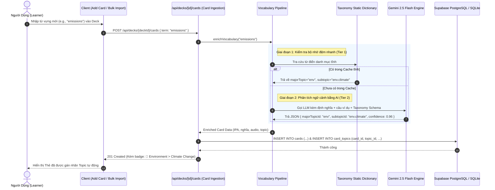
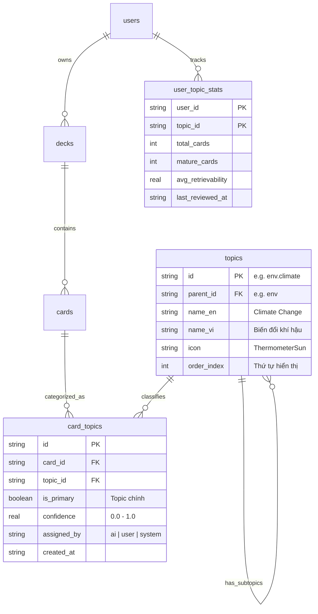
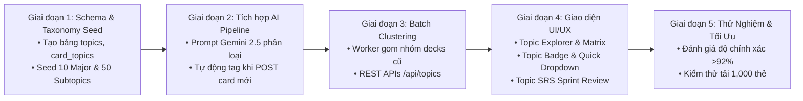

# Tài Liệu Đề Xuất Kỹ Thuật: Hệ Thống Phân Tầng Chủ Đề & Tự Động Gom Nhóm Từ Vựng (Hierarchical Topic Taxonomy & Automated Vocabulary Clustering Engine)

> **Mã tài liệu:** `DOC-FEAT-013`  
> **Phiên bản đề xuất:** `v1.4.0-proposal`  
> **Trạng thái:** `Under Review / Implementation Ready`  
> **Ngày lập:** 04/11/2026  
> **Tác giả:** Architecture & Pedagogy Engineering Team  
> **Hệ thống áp dụng:** LinguaFlow (Next.js 16 App Router + Supabase / SQLite + Google Gemini 2.5)

---

## 1. Tóm Tắt Dự Án & Động Lực Phát Triển (Executive Summary & Motivation)

### 1.1 Vấn Đề Thực Tế (Problem Statement)
Trong các phiên bản hiện tại của LinguaFlow, người dùng quản lý từ vựng thông qua **Decks (Bộ thẻ)** mang tính chất tùy biến cao:
- **Tạo deck ngẫu hứng:** Người học thường gom từ theo tình huống tạm thời (*"Unit 5 Tiếng Anh đại học"*, *"Từ mới đọc báo BBC ngày 12/10"*, *"IELTS Reading Cambridge 18 Test 2"*, *"Từ vựng xem phim Friends"*).
- **Phân mảnh & Trùng lặp tri thức (Knowledge Fragmentation):** Từ vựng cùng một chủ đề ngữ nghĩa (ví dụ: các từ về biến đổi khí hậu như *emissions, reforestation, biodiversity, carbon footprint*) bị nằm rải rác ở 4–5 deck khác nhau.
- **Mất tính hệ thống sư phạm (Lack of Semantic Structure):** Theo lý thuyết *Semantic Network & Schema Theory* trong ngôn ngữ học ứng dụng, não bộ ghi nhớ và kích hoạt từ vựng nhanh hơn **40–60%** khi từ được tổ chức thành một mạng lưới liên tưởng theo chủ đề (Thematic Schema), thay vì danh sách từ ngẫu nhiên không có sự tương hỗ về mặt ngữ cảnh.
- **Bất tiện khi chuẩn bị mục tiêu ngắn hạn:** Khi cần luyện thi cấp tốc (ví dụ: *"Tuần tới thi Speaking Part 2 về Environment"* hoặc *"Phỏng vấn xin việc về Kinh doanh"*), người học không có cách nào gom nhanh 50 từ liên quan từ kho dữ liệu cá nhân nếu không tự nhặt thủ công từng thẻ.

```
[Hiện trạng: Từ vựng bị cô lập theo Deck]
Deck "BBC News 12/10"  ───> [greenhouse effect, fossil fuels, drought]
Deck "IELTS Cambridge" ───> [renewable energy, carbon tax]
Deck "Daily Reading"   ───> [deforestation, global warming]
   ==> Người học KHÔNG có cái nhìn tổng hợp về Vốn từ vựng Môi Trường (Environment)!

[Kỳ vọng: Cây Chủ Đề Phân Tầng Thông Minh (Hierarchical Topic Taxonomy)]
🌿 Environment & Nature (Chủ đề Lớn)
  ├── 🌍 Climate Change & Global Warming (Subtopic) ───> [greenhouse effect, global warming, carbon tax]
  ├── ⚡ Renewable Energy & Resources (Subtopic)    ───> [renewable energy, fossil fuels]
  └── 🌲 Conservation & Biodiversity (Subtopic)     ───> [deforestation, drought]
```

### 1.2 Mục Tiêu Đề Xuất (Core Objectives)
Tài liệu này đề xuất thiết kế và triển khai tính năng **Phân loại & Gom nhóm từ vựng tự động (Automated Topic Clustering & Ingestion)** với 3 cột trụ:
1. **Cây Chủ Đề Chuẩn Hóa Phân Tầng (Hierarchical Topic Taxonomy):** Thiết lập sẵn danh mục gồm **10 Chủ đề Lớn (Major Domains)** và hơn **50 Chủ đề Nhỏ (Specialized Subtopics)** chuẩn học thuật quốc tế (Cambridge & IELTS Topics).
2. **Cơ Chế Gom Tự Động Hai Chiều (Dual Automated Engine):**
   - **Quét & Gom hàng loạt (Batch Deck Clustering):** Quét toàn bộ từ vựng hiện có trong tất cả các deck của người dùng để phân tích và lập chỉ mục vào cây topic mà không làm xáo trộn cấu trúc deck gốc.
   - **Tự động phân loại thời gian thực (Real-time Ingestion Tagging):** Khi người dùng tạo hoặc nhập từ mới vào bất kỳ deck nào, hệ thống AI (Gemini 2.5 Flash) tự động xác định Major Topic và Subtopic phù hợp nhất dựa trên ngữ cảnh và ví dụ của từ.
3. **Trải Nghiệm Học Tập Hợp Nhất (Cross-Deck Topic Explorer & Sprint Review):** Cho phép xem tổng thể độ bao phủ từ vựng (Vocabulary Coverage), tiến độ SRS theo từng chủ đề, và khởi tạo ngay các phiên ôn tập DSR/SRS tập trung theo chuyên đề.

---

## 2. Cây Chủ Đề Thông Dụng Chuẩn Hóa (Standard Topic Taxonomy Architecture)

Cây chủ đề được thiết kế theo cấu trúc phân tầng **2 cấp độ (2-Tier Hierarchy)** chuẩn hóa dựa trên các giáo trình quốc tế (*Cambridge Vocabulary for IELTS, Oxford 3000/5000 Topics, CEFR Lexical Domains*).

```mermaid
graph TD
    Taxonomy[LinguaFlow Global Taxonomy] --> T1[1. Environment & Nature]
    Taxonomy --> T2[2. Science & Technology]
    Taxonomy --> T3[3. Business, Work & Economy]
    Taxonomy --> T4[4. Education & Academia]
    Taxonomy --> T5[5. Health, Medicine & Wellness]
    Taxonomy --> T6[6. Society, Culture & Law]
    Taxonomy --> T7[7. Urbanization & Infrastructure]
    Taxonomy --> T8[8. Travel & Hospitality]
    Taxonomy --> T9[9. Daily Life & Personal Finance]
    Taxonomy --> T10[10. Global Politics & Humanitarian]

    T1 --> T1_1["1.1 Climate Change & Emissions"]
    T1 --> T1_2["1.2 Wildlife & Biodiversity"]
    T1 --> T1_3["1.3 Renewable Energy & Resources"]
    T1 --> T1_4["1.4 Pollution & Waste Management"]

    T2 --> T2_1["2.1 Artificial Intelligence & Automation"]
    T2 --> T2_2["2.2 IT, Cloud & Cybersecurity"]
    T2 --> T2_3["2.3 Space Exploration & Astronomy"]
    T2 --> T2_4["2.4 Biotechnology & Genetics"]

    T3 --> T3_1["3.1 Careers, Employment & Recruitment"]
    T3 --> T3_2["3.2 Corporate Finance & Banking"]
    T3 --> T3_3["3.3 Marketing, Branding & Consumers"]
    T3 --> T3_4["3.4 Management & Operations"]
```



### 2.1 Chi Tiết Danh Mục 10 Chủ Đề Lớn & Subtopics

| ID | Major Topic (Chủ đề Lớn) | Subtopics (Chủ đề Nhỏ) | Ví Dụ Từ Vựng Đại Diện |
| :--- | :--- | :--- | :--- |
| **`env`** | **Environment & Nature** *(Môi trường & Thiên nhiên)* | `env.climate` (Climate Change & Global Warming)<br>`env.wildlife` (Biodiversity & Wildlife Conservation)<br>`env.pollution` (Pollution, Waste & Recycling)<br>`env.energy` (Renewable Energy & Natural Resources)<br>`env.disaster` (Natural Disasters & Geography) | *emissions, biodiversity, drought, solar panel, deforestation, torrential rain* |
| **`tech`** | **Science & Technology** *(Khoa học & Công nghệ)* | `tech.ai` (Artificial Intelligence & Automation)<br>`tech.cyber` (Cybersecurity & Information Systems)<br>`tech.space` (Space Exploration & Astronomy)<br>`tech.bio` (Biotechnology & Genetics)<br>`tech.digital` (Digital Transformation & Devices) | *algorithm, neural network, encryption, celestial body, clone, wearable device* |
| **`biz`** | **Business & Economy** *(Kinh doanh & Kinh tế)* | `biz.career` (Employment, Recruitment & Workplace)<br>`biz.finance` (Corporate Finance, Investment & Banking)<br>`biz.marketing` (Marketing, Advertising & Branding)<br>`biz.trade` (International Trade & Macroeconomics)<br>`biz.leadership` (Corporate Leadership & Negotiation) | *severance pay, liquidity, market penetration, tariff, stakeholder, consensus* |
| **`edu`** | **Education & Academia** *(Giáo dục & Học thuật)* | `edu.university` (Higher Education & Campus Life)<br>`edu.pedagogy` (Teaching Methodologies & E-Learning)<br>`edu.exams` (Assessments, Grading & Credentials)<br>`edu.research` (Academic Writing & Scientific Research) | *curriculum, tuition fee, peer review, plagiarism, dissertation, pedagogical* |
| **`health`**| **Health & Wellness** *(Sức khỏe & Y học)* | `health.diet` (Nutrition, Diet & Physical Fitness)<br>`health.mental` (Mental Health & Psychology)<br>`health.disease` (Diseases, Pandemics & Pathology)<br>`health.care` (Healthcare Systems & Pharmacology) | *sedentary lifestyle, resilience, burnout, epidemiology, diagnosis, prescription* |
| **`soc`** | **Society & Culture** *(Xã hội, Văn hóa & Pháp luật)* | `soc.equality` (Diversity, Gender & Social Mobility)<br>`soc.arts` (Visual Arts, Literature & Music)<br>`soc.heritage` (History, Traditions & Customs)<br>`soc.law` (Crime, Law Enforcement & Justice) | *marginalized, avant-garde, folklore, delinquency, jurisprudence, heritage* |
| **`urban`**| **Urban & Living** *(Đô thị & Nhà ở)* | `urban.planning` (Smart Cities & Urban Density)<br>`urban.transit` (Public Transportation & Infrastructure)<br>`urban.housing` (Real Estate, Architecture & Interior) | *gentrification, congestion charge, skyscraper, zoning laws, public amenity* |
| **`travel`**| **Travel & Hospitality** *(Du lịch & Dịch vụ)* | `travel.eco` (Sightseeing & Sustainable Tourism)<br>`travel.aviation` (Aviation, Hotels & Accommodations)<br>`travel.customs` (Cultural Etiquette & Expatriate Life) | *itinerary, hospitality, layover, cultural immersion, souvenir, eco-lodge* |
| **`life`** | **Daily Life & Relationships** *(Đời sống & Cá nhân)* | `life.family` (Family Dynamics, Parenting & Friendship)<br>`life.food` (Culinary Arts, Cooking & Dining)<br>`life.finance` (Personal Budgeting, Saving & Taxes)<br>`life.leisure` (Hobbies, Entertainment & Sports) | *upbringing, gourmet, frugality, mortgage, amateur, camaraderie* |
| **`gov`** | **Global Politics & Affairs** *(Chính trị & Quan hệ quốc tế)*| `gov.diplomacy` (Diplomacy, Treaties & Alliances)<br>`gov.aid` (Humanitarian Aid, Poverty Alleviation)<br>`gov.globalization` (Global Supply Chain & Treaties) | *sanction, bilateral, treaty, refugee, geopolitical, foreign aid* |

---

## 3. Kiến Trúc Kỹ Thuật & Luồng Xử Lý (Technical Architecture & Pipelines)

Hệ thống kết hợp giữa **phân tích ngữ nghĩa AI (Gemini 2.5 Flash)**, **bộ nhớ đệm từ vựng định danh (Static Canonical Cache)** và **cơ chế xác nhận người dùng (Human-in-the-loop)**.



### 3.1 Quy Trình Phân Loại Đa Tầng (Multi-Tier Classification Engine)

Để tối ưu chi phí vận hành (**nguyên tắc $0/tháng**) và đảm bảo độ trễ thấp (< 250ms), thuật toán phân loại tuân thủ 3 tầng:

1. **Tier 1 - Exact Keyword & Synset Cache (O(1) Local Lookup):**
   - Bộ danh mục tĩnh gồm 2,000 từ vựng cốt lõi học thuật (AWL - Academic Word List) và danh mục Cambridge Collocations đã được lập chỉ mục sẵn trong repository.
   - Nếu từ khớp chính xác với lemma có sẵn trong seed database, gán ngay lập tức mà không cần gọi API ngoài.
2. **Tier 2 - Contextual Zero-Shot Classification via Gemini 2.5 Flash:**
   - Khi từ không có trong cache hoặc là từ đa nghĩa (*Polysemous Words*), pipeline đưa toàn bộ ngữ cảnh gồm: `term`, `partOfSpeech`, `vietnameseDefinition`, `exampleSentence` vào Gemini prompt.
   - Gemini xem xét câu ví dụ để xác định ngữ nghĩa cụ thể:
     - *Ví dụ 1:* Từ **"bank"** trong câu *"He sat on the river **bank** to fish"* $\rightarrow$ Topic: `env.disaster` / `life.leisure`.
     - *Ví dụ 2:* Từ **"bank"** trong câu *"The central **bank** raised interest rates to combat inflation"* $\rightarrow$ Topic: `biz.finance`.
   - Sử dụng cơ chế Structured JSON Output (Schema Validation) để đảm bảo kết quả luôn trả về đúng mã định danh `topic_id`.
3. **Tier 3 - Ghi Đè & Học Từ Người Dùng (User-Override & Fine-Tuning):**
   - Giao diện cung cấp cho người học badge topic có thể nhấp để thay đổi nhanh (*1-click override*).
   - Khi người học thay đổi topic, hệ thống lưu cờ `assigned_by = 'user'` và lưu vết để cá nhân hóa phân loại trong các lần sau.

### 3.2 Quy Trình Quét Gom Nhóm Hàng Loạt (Batch Deck Clustering Pipeline)

Đối với các decks đã có sẵn trong hệ thống của người dùng:
1. **Trigger:** Người dùng bấm nút *"Tự động phân loại toàn bộ kho từ vựng"* trong màn hình Topic Explorer hoặc Decks Overview.
2. **Chunking & Batching:** Hệ thống gom các thẻ chưa có topic thành từng đợt (batches) gồm **30–50 từ/lần gọi**.
3. **Bulk Gemini Analysis:** Một lời gọi prompt duy nhất xử lý 50 từ cùng lúc, giảm thiểu số lượng token và số lần gọi API (tránh rate-limit 15 RPM của gói Free).
4. **Bulk Upsert:** Sử dụng `bulkInsert` hoặc `executeBatch` của Drizzle ORM để cập nhật bảng trung gian `card_topics`.

---

## 4. Thiết Kế Cơ Sở Dữ Liệu (Database Schema)

Để tương thích hoàn toàn với kiến trúc đa cơ sở dữ liệu hiện tại của LinguaFlow (**Supabase PostgreSQL** cho production và **SQLite** cho môi trường phát triển cục bộ), schema được xây dựng với tính tương thích cao qua Drizzle ORM.

### 4.1 Mô Hình Thực Thể Quan Hệ (Entity-Relationship Diagram)



### 4.2 SQL Script Di Trú (Supabase PostgreSQL Migration)

File lưu tại: `prototype-interface/lib/db/supabase_topic_schema.sql`

```sql
-- ============================================================================
-- LinguaFlow Topic Taxonomy & Auto-Clustering Migration
-- Compatible with PostgreSQL 15+ & Supabase RLS
-- ============================================================================

-- 1. Bảng danh mục Chủ Đề Phân Tầng (Hierarchical Topics)
CREATE TABLE IF NOT EXISTS topics (
    id VARCHAR(50) PRIMARY KEY,                 -- e.g., 'env', 'env.climate', 'tech.ai'
    parent_id VARCHAR(50) REFERENCES topics(id) ON DELETE CASCADE,
    name_en VARCHAR(100) NOT NULL,              -- e.g., 'Climate Change & Global Warming'
    name_vi VARCHAR(100) NOT NULL,              -- e.g., 'Biến đổi khí hậu & Nóng lên toàn cầu'
    description TEXT,
    icon VARCHAR(50) DEFAULT 'Folder',          -- Lucide icon name: 'Leaf', 'Cpu', 'Briefcase'
    color VARCHAR(20) DEFAULT '#3B82F6',         -- Hex color for UI badges
    order_index INT DEFAULT 0,
    created_at TIMESTAMPTZ DEFAULT NOW()
);

CREATE INDEX IF NOT EXISTS idx_topics_parent ON topics(parent_id);

-- 2. Bảng liên kết Thẻ Từ Vựng và Chủ Đề (N-N Relationship)
CREATE TABLE IF NOT EXISTS card_topics (
    id VARCHAR(100) PRIMARY KEY,
    card_id VARCHAR(100) NOT NULL REFERENCES cards(id) ON DELETE CASCADE,
    topic_id VARCHAR(50) NOT NULL REFERENCES topics(id) ON DELETE CASCADE,
    is_primary BOOLEAN NOT NULL DEFAULT TRUE,   -- Topic chính của thẻ
    confidence REAL DEFAULT 1.0,                -- Điểm tự tin của AI (0.00 -> 1.00)
    assigned_by VARCHAR(20) DEFAULT 'ai',       -- 'ai', 'user', 'system_seed'
    created_at TIMESTAMPTZ DEFAULT NOW(),
    CONSTRAINT uq_card_topic UNIQUE(card_id, topic_id)
);

CREATE INDEX IF NOT EXISTS idx_card_topics_card ON card_topics(card_id);
CREATE INDEX IF NOT EXISTS idx_card_topics_topic ON card_topics(topic_id);
CREATE INDEX IF NOT EXISTS idx_card_topics_primary ON card_topics(card_id, is_primary);

-- 3. Bảng thống kê tiến độ học theo Topic của từng User
CREATE TABLE IF NOT EXISTS user_topic_stats (
    user_id VARCHAR(100) NOT NULL REFERENCES users(id) ON DELETE CASCADE,
    topic_id VARCHAR(50) NOT NULL REFERENCES topics(id) ON DELETE CASCADE,
    total_cards INT NOT NULL DEFAULT 0,
    learning_cards INT NOT NULL DEFAULT 0,
    mature_cards INT NOT NULL DEFAULT 0,
    avg_retrievability REAL NOT NULL DEFAULT 0.0,
    last_studied_at TIMESTAMPTZ,
    updated_at TIMESTAMPTZ DEFAULT NOW(),
    PRIMARY KEY (user_id, topic_id)
);

CREATE INDEX IF NOT EXISTS idx_user_topic_stats_user ON user_topic_stats(user_id);

-- 4. Enable Row Level Security (RLS) cho Supabase
ALTER TABLE topics ENABLE ROW LEVEL SECURITY;
ALTER TABLE card_topics ENABLE ROW LEVEL SECURITY;
ALTER TABLE user_topic_stats ENABLE ROW LEVEL SECURITY;

-- Policy: Mọi người đều có thể đọc bảng danh mục Topics
CREATE POLICY "Topics are public readable" ON topics FOR SELECT USING (true);

-- Policy: Người dùng chỉ xem/sửa quan hệ topic của các thẻ thuộc quyền sở hữu của họ
CREATE POLICY "Users can manage card_topics of their own cards" ON card_topics
    FOR ALL USING (
        EXISTS (
            SELECT 1 FROM cards
            JOIN decks ON cards.deck_id = decks.id
            WHERE cards.id = card_topics.card_id AND decks.user_id = auth.uid()::text
        )
    );

CREATE POLICY "Users can manage their own topic stats" ON user_topic_stats
    FOR ALL USING (user_id = auth.uid()::text);
```

### 4.3 Định Nghĩa Drizzle ORM Schema (TypeScript)

Thêm vào `prototype-interface/lib/db/schema.ts` (SQLite) và `prototype-interface/lib/db/pg_schema.ts` (PostgreSQL):

```typescript
// Định nghĩa Drizzle ORM (schema.ts)
import { sqliteTable, text, integer, real } from 'drizzle-orm/sqlite-core'
import { cards, users } from './schema'

export const topics = sqliteTable('topics', {
  id: text('id').primaryKey(), // 'env', 'env.climate'
  parentId: text('parent_id'),
  nameEn: text('name_en').notNull(),
  nameVi: text('name_vi').notNull(),
  description: text('description'),
  icon: text('icon').default('Folder'),
  color: text('color').default('#3B82F6'),
  orderIndex: integer('order_index').default(0),
  createdAt: text('created_at').notNull().$defaultFn(() => new Date().toISOString()),
})

export const cardTopics = sqliteTable('card_topics', {
  id: text('id').primaryKey(),
  cardId: text('card_id').notNull().references(() => cards.id, { onDelete: 'cascade' }),
  topicId: text('topic_id').notNull().references(() => topics.id, { onDelete: 'cascade' }),
  isPrimary: integer('is_primary', { mode: 'boolean' }).notNull().default(true),
  confidence: real('confidence').default(1.0),
  assignedBy: text('assigned_by').default('ai'), // 'ai' | 'user' | 'system'
  createdAt: text('created_at').notNull().$defaultFn(() => new Date().toISOString()),
})

export const userTopicStats = sqliteTable('user_topic_stats', {
  userId: text('user_id').notNull().references(() => users.id, { onDelete: 'cascade' }),
  topicId: text('topic_id').notNull().references(() => topics.id, { onDelete: 'cascade' }),
  totalCards: integer('total_cards').notNull().default(0),
  learningCards: integer('learning_cards').notNull().default(0),
  matureCards: integer('mature_cards').notNull().default(0),
  avgRetrievability: real('avg_retrievability').notNull().default(0.0),
  lastStudiedAt: text('last_studied_at'),
  updatedAt: text('updated_at').notNull().$defaultFn(() => new Date().toISOString()),
})
```

---

## 5. Tích Hợp Vào AI Pipeline & Triển Khai Logic Phân Loại

Tích hợp việc tự động phân loại trực tiếp vào `prototype-interface/services/vocabulary-pipeline.ts` và `gemini-service.ts`. Bằng cách gộp bước phân loại vào cùng một lời gọi API lúc làm giàu thẻ từ (Enrichment), thời gian phản hồi và số lượng request tới Gemini được giữ nguyên mà không phát sinh thêm chi phí.

### 5.1 Cấu Trúc Prompt Gemini Nhận Diện Topic

Cập nhật hàm `fetchGeminiEnrichment` trong `prototype-interface/services/gemini-service.ts`:

```typescript
// Interface mở rộng chứa kết quả Topic Classification
export interface TopicClassification {
  majorTopicId: string;    // 'env', 'biz', 'tech', ...
  majorTopicName: string;  // 'Environment & Nature'
  subtopicId: string;      // 'env.climate', 'biz.marketing', ...
  subtopicName: string;    // 'Climate Change & Global Warming'
  confidence: number;      // 0.0 to 1.0
  secondarySubtopicId?: string; // Tùy chọn nếu từ thuộc nhiều lĩnh vực
}

export interface EnrichedVocabularyWithTopic extends GeminiEnrichmentData {
  topicClassification: TopicClassification;
}
```

```text
Prompt mở rộng gửi tới Gemini:
"You are a linguistic taxonomy expert for English learning (IELTS/CEFR).
Analyze the English term and categorize it into the standard hierarchical taxonomy below:

TAXONOMY DOMAINS:
- env (Environment & Nature): env.climate, env.wildlife, env.pollution, env.energy, env.disaster
- tech (Science & Technology): tech.ai, tech.cyber, tech.space, tech.bio, tech.digital
- biz (Business & Economy): biz.career, biz.finance, biz.marketing, biz.trade, biz.leadership
- edu (Education & Academia): edu.university, edu.pedagogy, edu.exams, edu.research
- health (Health & Wellness): health.diet, health.mental, health.disease, health.care
- soc (Society & Culture): soc.equality, soc.arts, soc.heritage, soc.law
- urban (Urban & Living): urban.planning, urban.transit, urban.housing
- travel (Travel & Hospitality): travel.eco, travel.aviation, travel.customs
- life (Daily Life & Personal): life.family, life.food, life.finance, life.leisure
- gov (Global Politics): gov.diplomacy, gov.aid, gov.globalization

Analyze context:
Word: "{word}"
Part of Speech: "{partOfSpeech}"
Definition: "{vietnameseMeaning}"
Sentence: "{exampleSentence}"

Return strict JSON object:
{
  "majorTopicId": "env",
  "majorTopicName": "Environment & Nature",
  "subtopicId": "env.climate",
  "subtopicName": "Climate Change & Global Warming",
  "confidence": 0.95
}"
```

### 5.2 Xử Lý Khi Người Dùng Thêm Thẻ Mới (`POST /api/decks/[id]/cards`)

Trong file `prototype-interface/app/api/decks/[id]/cards/route.ts`:
1. Khi thẻ được insert vào bảng `cards`, trích xuất thông tin `topicClassification`.
2. Tự động insert một bản ghi vào bảng `card_topics` với `isPrimary = true` và `assignedBy = 'ai'`.
3. Tăng bộ đếm `total_cards` trong bảng `user_topic_stats` tương ứng với `userId` và `subtopicId`.

```typescript
// Trích đoạn logic chèn topic tự động khi thêm thẻ
await db.insert(cardTopics).values({
  id: `ct_${Date.now()}_${Math.random().toString(36).substring(2, 7)}`,
  cardId: newCard.id,
  topicId: enrichedResult.topicClassification.subtopicId,
  isPrimary: true,
  confidence: enrichedResult.topicClassification.confidence || 0.9,
  assignedBy: 'ai',
  createdAt: new Date().toISOString()
})
```

---

## 6. Thiết Kế Giao Diện & Trải Nghiệm Người Dùng (UI/UX Specification)

### 6.1 Màn Hình "Topic Explorer & Matrix" (Khám Phá Theo Chủ Đề)

Bổ sung một menu mới trên thanh điều hướng chính: **"Topics (Chủ Đề)"** bên cạnh *Decks*, *Collocations*, *Translation*, và *Analytics*.

```
+-----------------------------------------------------------------------------------------+
|  LINGUAFLOW        Decks   [Topics]   Collocations   Translation   Speaking   [Alex Lee]|
+-----------------------------------------------------------------------------------------+
|  📚 BẢN ĐỒ TRI THỨC TỪ VỰNG THEO CHỦ ĐỀ (VOCABULARY TOPIC EXPLORER)                     |
|  Gom nhóm tự động 842 từ vựng từ 12 Decks của bạn vào 10 Chủ đề Học thuật chuẩn         |
|                                                                                         |
|  [ ⚡ Tự Động Quét & Gom Toàn Bộ Decks ]     [ 🔍 Tìm từ hoặc chủ đề... ]               |
+-----------------------------------------------------------------------------------------+
|                                                                                         |
|  +-----------------------------------+  +------------------------------------+          |
|  | 🌿 Environment & Nature           |  | 💼 Business, Work & Economy        |          |
|  | 142 từ • 68% Nhớ Vững (Mature)    |  | 210 từ • 54% Nhớ Vững (Mature)     |          |
|  | [===========---------] 68%        |  | [==========----------] 54%         |          |
|  |                                   |  |                                    |          |
|  | ▸ Climate Change (58 từ) [Luyện]  |  | ▸ Corporate Finance (64 từ) [Luyện]|          |
|  | ▸ Wildlife Conservation (42 từ)   |  | ▸ Careers & Hiring (86 từ)         |          |
|  | ▸ Renewable Energy (26 từ)        |  | ▸ Marketing & Branding (38 từ)     |          |
|  | ▸ Pollution & Waste (16 từ)       |  | ▸ Management (22 từ)               |          |
|  |                                   |  |                                    |          |
|  | [ Xem 142 từ ] [ Ôn Tập Topic ]   |  | [ Xem 210 từ ] [ Ôn Tập Topic ]    |          |
|  +-----------------------------------+  +------------------------------------+          |
|                                                                                         |
|  +-----------------------------------+  +------------------------------------+          |
|  | 🔬 Science & Technology           |  | 🎓 Education & Academia            |          |
|  | 115 từ • 72% Nhớ Vững (Mature)    |  | 98 từ • 80% Nhớ Vững (Mature)      |          |
|  | [==============------] 72%        |  | [================----] 80%         |          |
|  +-----------------------------------+  +------------------------------------+          |
+-----------------------------------------------------------------------------------------+
```

### 6.2 Thẻ Từ Vựng Thông Minh Với Badge Chủ Đề (Card Badge & Quick Switch)

Trong chế độ xem Deck thông thường và giao diện Flashcard:
- Mỗi thẻ hiển thị **Pill Badge** hiển thị topic và subtopic (ví dụ: `🌿 Environment > Climate Change`).
- **Quick Topic Switcher:** Nhấp vào badge sẽ mở một dropdown nhanh cho phép người học chọn lại subtopic khác nếu AI nhận diện chưa đúng mong muốn, thao tác lưu ngay lập tức trong 1 click.

```
+----------------------------------------------------------------------+
|  Card: emissions                                      [🔊 UK] [🔊 US]|
|  /iˈmɪʃ.ənz/ • Noun • CEFR B2                                        |
|                                                                      |
|  [🏷️ 🌿 Environment > Climate Change ▾] (Tự động gán bởi AI - 96%)   |
|                                                                      |
|  Định nghĩa: Khí thải, chất thải phát tán vào khí quyển              |
|  Ví dụ: "Stricter regulations were imposed to curb greenhouse        |
|          gas emissions from heavy industries."                       |
|                                                                      |
|  Thuộc Deck: [IELTS Reading Academic - Cambridge 18]                 |
+----------------------------------------------------------------------+
```

### 6.3 Chế Độ Ôn Luyện Tập Trung "Topic SRS Sprint"

Người học có thể bấm **"Ôn Tập Topic"** tại bất kỳ Subtopic nào:
- Hệ thống sẽ lọc toàn bộ thẻ thuộc Subtopic đó (bất kể thẻ thuộc Deck nào).
- Sắp xếp theo thứ tự ưu tiên: Các từ đến hạn ôn (`due_date <= NOW()`) $\rightarrow$ Các từ đang học (`Learning`) $\rightarrow$ Các từ nhớ vững (`Mature`).
- Áp dụng đầy đủ thuật toán **DSR / SuperMemo SM-2** sẵn có và cập nhật điểm Retrievability sau phiên học.

---

## 7. Thiết Kế Chi Tiết Các API Endpoints (API Specification)

### 7.1 Lấy Cây Chủ Đề & Thống Kê Người Dùng
- **Endpoint:** `GET /api/topics`
- **Mô tả:** Lấy toàn bộ cây chủ đề phân tầng kèm số lượng từ vựng và tiến độ nhớ của user hiện tại.
- **Response `200 OK`:**
```json
{
  "topics": [
    {
      "id": "env",
      "nameEn": "Environment & Nature",
      "nameVi": "Môi trường & Thiên nhiên",
      "icon": "Leaf",
      "color": "#10B981",
      "totalUserCards": 142,
      "matureCards": 96,
      "subtopics": [
        {
          "id": "env.climate",
          "nameEn": "Climate Change & Global Warming",
          "nameVi": "Biến đổi khí hậu & Nóng lên toàn cầu",
          "cardCount": 58,
          "dueCount": 12
        },
        {
          "id": "env.wildlife",
          "nameEn": "Biodiversity & Wildlife Conservation",
          "nameVi": "Đa dạng sinh học & Bảo tồn hoang dã",
          "cardCount": 42,
          "dueCount": 5
        }
      ]
    }
  ]
}
```

### 7.2 Lấy Danh Sách Từ Vựng Thuộc Topic (Cross-Deck)
- **Endpoint:** `GET /api/topics/[topicId]/cards`
- **Query Params:** `?page=1&limit=50&status=all&deckId=`
- **Response `200 OK`:**
```json
{
  "topic": {
    "id": "env.climate",
    "nameEn": "Climate Change & Global Warming",
    "nameVi": "Biến đổi khí hậu"
  },
  "totalCards": 58,
  "cards": [
    {
      "id": "card_1728001",
      "term": "emissions",
      "vietnameseDefinition": "Khí thải phát tán ra môi trường",
      "cefrLevel": "B2",
      "deckId": "deck_ielts_cambridge",
      "deckTitle": "IELTS Academic Cambridge 18",
      "srsState": {
        "stability": 8.4,
        "difficulty": 4.2,
        "dueDate": "2026-11-08T10:00:00Z"
      }
    }
  ]
}
```

### 7.3 Kích Hoạt Quét & Gom Nhóm Hàng Loạt Toàn Bộ Decks
- **Endpoint:** `POST /api/topics/auto-cluster`
- **Payload:**
```json
{
  "scope": "all_decks", // hoặc "specific_deck"
  "deckId": null,
  "forceReclassify": false // true: phân loại lại cả thẻ đã có topic
}
```
- **Response `200 OK`:**
```json
{
  "success": true,
  "processedCount": 145,
  "classifiedCount": 142,
  "skippedCount": 3,
  "summary": {
    "env.climate": 24,
    "tech.ai": 31,
    "biz.finance": 18
  }
}
```

### 7.4 Cập Nhật / Ghi Đè Topic Cho Thẻ
- **Endpoint:** `PATCH /api/cards/[id]/topics`
- **Payload:**
```json
{
  "subtopicId": "env.energy",
  "isPrimary": true
}
```
- **Response `200 OK`:** Trả về thẻ kèm liên kết topic mới và cập nhật `assigned_by: "user"`.

---

## 8. Các Ca Biên & Phương Án Xử Lý (Edge Cases & Resilience)

| Tình Huống Biên (Edge Case) | Nguy Cơ Kỹ Thuật | Phương Án Xử Lý Chi Tiết |
| :--- | :--- | :--- |
| **Từ đa nghĩa (Polysemy)**<br>*(Ví dụ: "yield" vừa là sản lượng nông nghiệp, vừa là lợi suất tài chính)* | AI đoán sai lĩnh vực nếu chỉ nhìn mặt chữ. | **Context-Aware Prompting:** Luôn truyền cả `exampleSentence` và `vietnameseDefinition` của thẻ vào Gemini để xác định nghĩa chính xác theo ngữ cảnh thẻ. |
| **Từ vựng chức năng / Nói chung**<br>*(Ví dụ: "however", "consequently", "significant")* | Không thuộc riêng một chuyên ngành tự nhiên hay xã hội nào. | Đưa vào danh mục bổ trợ: `edu.academic_discourse` *(Từ vựng liên kết học thuật & Writing Task 2)*. |
| **Vượt giới hạn Gemini API Rate Limit**<br>*(429 Too Many Requests khi quét 500 từ)* | Quá trình quét hàng loạt bị gián đoạn giữa chừng. | **Batching & Exponential Backoff:** Gom 30 từ/lời gọi prompt, giới hạn tối đa 10 batch/phút, tự động thử lại sau $2^n$ giây khi gặp mã 429. |
| **Xóa Deck hoặc Xóa Card** | Dữ liệu rác còn tồn đọng trong bảng quan hệ `card_topics`. | Khóa ngoại có thiết lập `ON DELETE CASCADE` tự động dọn dẹp các bản ghi liên quan; cập nhật lại `user_topic_stats`. |
| **Người dùng Offline / Mất mạng** | Không gọi được Gemini để phân loại từ mới. | Thẻ vẫn được thêm vào Deck bình thường, gán nhãn tạm thời `topic_id = 'unclassified'`. Hệ thống đưa vào hàng đợi `pending_topic_queue` để xử lý khi kết nối lại. |

---

## 9. Kế Hoạch Triển Khai Phân Kỳ (Phased Implementation Roadmap)



| Giai Đoạn | Công Việc Cụ Thể | Thời Lượng | Output Bàn Giao |
| :--- | :--- | :--- | :--- |
| **Giai đoạn 1: Cơ sở dữ liệu & Seed** | • Tạo bảng `topics`, `card_topics`, `user_topic_stats` trong Drizzle ORM (PostgreSQL & SQLite)<br>• Tạo seed data chuẩn hóa 10 Major Domains và 50 Subtopics chuẩn Cambridge/IELTS | 5 ngày | File migration SQL & file seed `initial_topics.ts` |
| **Giai đoạn 2: AI Pipeline & Ingestion** | • Nâng cấp `gemini-service.ts` để trích xuất `topicClassification`<br>• Cập nhật `POST /api/decks/[id]/cards` tự động gán nhãn Topic khi người dùng thêm thẻ mới<br>• Viết Unit Test xác thực độ chuẩn xác phân loại | 5 ngày | Thẻ mới tự động được gắn topic mà không tăng độ trễ |
| **Giai đoạn 3: Batch Clustering & API** | • Xây dựng Worker quét gom nhóm toàn bộ các thẻ hiện có trong tất cả các decks<br>• Xây dựng các API endpoints: `GET /api/topics`, `GET /api/topics/[id]/cards`, `POST /api/topics/auto-cluster` | 5 ngày | Bộ REST API hoàn chỉnh cho tính năng Topics |
| **Giai đoạn 4: Giao diện Người dùng** | • Xây dựng trang `app/topics/page.tsx` (Topic Explorer & Matrix)<br>• Tích hợp Topic Badge vào Flashcard UI & Quick Switcher<br>• Chế độ luyện tập tập trung *Topic SRS Sprint* | 7 ngày | UI hoàn chỉnh, responsive, hỗ trợ Dark/Light mode |
| **Giai đoạn 5: Thử nghiệm & Tối ưu** | • Thử nghiệm với kho dữ liệu mẫu 1,000 từ vựng thực tế<br>• Tối ưu prompt Gemini để duy trì độ chuẩn xác > 92%<br>• Đảm bảo chi phí API $0/tháng và giới hạn Rate Limit | 3 ngày | Báo cáo kiểm thử & tài liệu hướng dẫn người dùng |

---

## 10. Tiêu Chí Đo Lường Thành Công (Success Metrics & KPIs)

1. **Độ chính xác phân loại tự động (Auto-classification Accuracy):** Đạt trên **92%** từ vựng được phân loại vào đúng Subtopic trong lần đầu mà không cần người dùng chỉnh sửa thủ công.
2. **Độ trễ khi tạo thẻ mới:** Bước phân tích topic tích hợp trong `enrichVocabulary` không làm tăng tổng thời gian tạo thẻ quá **350ms**.
3. **Chi phí vận hành API:** Duy trì mức **$0.00/tháng** bằng cách tận dụng hạn mức Free Tier của Gemini Flash 2.5 và bộ nhớ đệm từ vựng tĩnh 2,000 từ.
4. **Mức độ tương tác (User Engagement):** Ít nhất **45%** số lượt ôn tập hàng tuần được người học thực hiện qua chế độ *Topic SRS Sprint*, thể hiện rõ tính hữu ích đối với việc học từ vựng có mục tiêu.

---

> 📌 **Ghi chú liên kết hệ thống:**
> - Tham chiếu chi tiết thuật toán giãn cách thời gian: xem [`06_Spaced_Repetition_Engine.md`](file:///d:/5/EN_web/documents/06_Spaced_Repetition_Engine.md).
> - Tham chiếu cấu trúc Pipeline làm giàu từ vựng: xem [`09_Vocabulary_Scraper_Pipeline.md`](file:///d:/5/EN_web/documents/09_Vocabulary_Scraper_Pipeline.md).
> - Tham chiếu danh mục Collocations học thuật theo chủ đề: xem [`collocation.md`](file:///d:/5/EN_web/documents/collocation.md).
