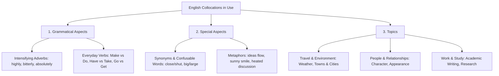

# Hướng Dẫn Kỹ Thuật: Tính Năng Học Collocation (Tích hợp DSR & Nguồn Tự Động)

Tài liệu này cung cấp phương án thiết kế tính năng học **Collocation (Cụm từ cố định)** cho hệ thống LinguaFlow. Dựa trên tài liệu tham khảo *"English Collocations in Use (Intermediate)"* của Cambridge, hệ thống phân nhóm chủ đề, triển khai bài tập tương tác và ứng dụng thuật toán Spaced Repetition (DSR) có sẵn.

---

## 1. Mục Tiêu Sư Phạm & Phương Pháp Học

Theo định nghĩa, **collocation** là cách các từ tiếng Anh kết hợp tự nhiên với nhau (ví dụ: *make mistakes*, không phải *do mistakes*). Việc học collocation mang lại các lợi ích lớn cho IELTS & giao tiếp học thuật:

1. **Tự nhiên & Chính xác:** Giúp văn phong tự nhiên, đúng chuẩn bản ngữ.
2. **Mở rộng vốn từ:** Cho phép diễn đạt chính xác, đa dạng thay vì lặp lại các từ cơ bản (ví dụ: dùng *bitterly cold* thay vì *very cold*, *a substantial meal* thay vì *a big meal*).
3. **Cải thiện điểm thi:** Đóng vai trò quan trọng trong tiêu chí Lexical Resource của các bài thi viết/nói học thuật (IELTS / TOEFL).

### Cách Học Hiệu Quả Đề Xuất (Theo Cambridge)

- **Nhận diện (Noticing):** Luyện thói quen phát hiện và ghi nhận collocation khi đọc hoặc nghe tiếng Anh.
- **Tra cứu đúng cách:** Sử dụng từ điển chuẩn (như *Cambridge Advanced Learner's Dictionary*) để tìm các cụm đi kèm của một từ mới.
- **Ghi chép theo cụm/ngữ cảnh:** Không học từ đơn lẻ. Cần ghi nhận collocation trong các cụm từ (phrases) hoặc câu trọn vẹn để thấy cách sử dụng thực tế.
- **Học theo nhóm (Grouping):** Nhóm các collocation theo chủ đề (ví dụ: *Weather, Travel*) hoặc theo từ khóa cốt lõi (ví dụ: các cụm đi với *make* hoặc *do*) để não bộ dễ liên kết.
- **Ôn tập thường xuyên & Thực hành:** Áp dụng hệ thống Spaced Repetition để ôn tập và cố gắng tự đặt câu với các cụm từ đó.

---

## 2. Kiến Trúc Bài Tập: "Collocation Match & Fill"

Hệ thống cung cấp 2 dạng bài tập ngắn gọn (mỗi câu < 5s) phù hợp với cơ chế lặp lại ngắt quãng (DSR).

### Dạng 1: Phân Loại (Categorisation / Sorting)

**Ứng dụng cho:** Các cặp động từ dễ nhầm lẫn như *Make / Do*, *Go / Get / Become*, *Have / Take / Pay*.

- **UI:** Hiển thị 2-3 cột (ví dụ: Cột "Make", Cột "Do"). Cung cấp một danh sách các danh từ/cụm từ (ví dụ: *an effort*, *damage*, *progress*).
- **Hành động:** Người học kéo/thả hoặc bấm chọn để phân loại danh từ vào đúng động từ đi kèm.
- **Đánh giá DSR:** Phân loại đúng ngay lập tức được đánh giá **"Good"** (Rating 3) hoặc **"Easy"** (Rating 4). Sai sẽ bị tính **"Again"** (Rating 1).

### Dạng 2: Điền Cụm Khuyết Tương Tác (Contextual Blank-filling)

**Ứng dụng cho:** Các collocation theo chủ đề (ví dụ: Travel, Weather, Work, Academic Writing).

- **UI:** Hiển thị một câu ngữ cảnh (lấy ví dụ từ sách) có phần khuyết.
  - *Ví dụ:* `"We stayed in a small, _______ hotel."` (Đáp án: *family-run*).
- **Hành động:**
  - **Chế độ cơ bản:** Bấm chọn 1 trong 4 đáp án (ví dụ: *family-made*, *family-run*, *family-kept*, *family-built*).
  - **Chế độ nâng cao (Hard Recall):** Gõ trực tiếp cụm từ vào ô trống.
- **Đánh giá DSR:**
  - Trả lời đúng lần đầu (< 3s): RATING 4 (*Easy*).
  - Trả lời đúng nhưng mất thời gian suy nghĩ: RATING 3 (*Good*).
  - Trả lời sai (hoặc bấm xem gợi ý/đáp án): RATING 1 (*Again*), cụm này sẽ lặp lại ngay trong đợt học (intra-batch) sau 2-3 câu.

---

## 3. Cấu Trúc Nhóm Chủ Đề (Theo "English Collocations in Use")

Dữ liệu được tổ chức trong Database theo các phân nhóm từ sách để tiện cho việc thiết kế giáo trình (Syllabus):



---

## 4. Kiến Trúc Dữ Liệu (Database Schema)

```sql
-- 1. Bảng lưu danh mục Collocations
CREATE TABLE IF NOT EXISTS collocations (
  id VARCHAR(64) PRIMARY KEY,
  category VARCHAR(100) NOT NULL,          -- Ví dụ: 'Everyday Verbs: Make/Do' hoặc 'Topic: Weather'
  head_word VARCHAR(100) NOT NULL,         -- Từ khóa chính, VD: 'heavy' hoặc 'make'
  tail_chunk VARCHAR(100) NOT NULL,        -- Cụm đi kèm, VD: 'rain' hoặc 'an effort'
  full_phrase VARCHAR(200) NOT NULL,       -- 'heavy rain' hoặc 'make an effort'
  context_sentence TEXT NOT NULL,          -- 'We had such heavy rain yesterday.'
  vietnamese_meaning TEXT NOT NULL,        -- 'mưa to, mưa nặng hạt'
  distractors JSONB,                       -- Mảng đáp án nhiễu, VD: ["strong rain", "hard rain", "big rain"]
  cefr_level VARCHAR(10) DEFAULT 'B2',     -- B1, B2, C1, C2
  created_at TIMESTAMPTZ DEFAULT NOW()
);

-- 2. Bảng trạng thái Spaced Repetition (DSR) cho Collocation
CREATE TABLE IF NOT EXISTS collocation_dsr_state (
  collocation_id VARCHAR(64) PRIMARY KEY REFERENCES collocations(id) ON DELETE CASCADE,
  user_id VARCHAR(64) NOT NULL,
  memory_level INT NOT NULL DEFAULT 1,
  difficulty FLOAT NOT NULL DEFAULT 5.0,
  stability FLOAT NOT NULL DEFAULT 0.5,
  reps INT NOT NULL DEFAULT 0,
  lapses INT NOT NULL DEFAULT 0,
  last_reviewed TIMESTAMPTZ,
  golden_time TIMESTAMPTZ NOT NULL
);
```

---

## 5. Nguồn Dữ Liệu & Cách Nạp (Ingestion Strategy)

Để lấy toàn bộ dữ liệu từ cuốn sách *"English Collocations in Use"* và đưa vào database tự động mà không phải gõ tay hàng ngàn dòng, hệ thống xây dựng **Data Ingestion Pipeline** bằng Node.js kết hợp trực tiếp với **Gemini 2.5 Flash API**.

### 1. Cài đặt thư viện phân tích PDF (nếu nạp trực tiếp từ file PDF)

```bash
npm install pdf-parse
npm install -D @types/pdf-parse
```

### 2. Script bóc tách dữ liệu (`scripts/seed-collocations-from-pdf.ts`)

```typescript
import fs from 'fs';
import pdf from 'pdf-parse';
import axios from 'axios';
import { db } from '../lib/db';
import { collocations } from '../lib/db/schema';

// Định nghĩa cấu trúc Collocation trích xuất từ Gemini
interface ExtractedCollocation {
  category: string;
  head_word: string;
  tail_chunk: string;
  full_phrase: string;
  context_sentence: string;
  vietnamese_meaning: string;
  distractors: string[];
  cefr_level?: string;
}

async function processChunk(chunkText: string, unitIndex: number): Promise<ExtractedCollocation[]> {
  const apiKey = process.env.GEMINI_API_KEY || process.env.NEXT_PUBLIC_GEMINI_API_KEY;
  if (!apiKey) throw new Error('GEMINI_API_KEY is missing');

  const prompt = `
  Bạn là một chuyên gia ngôn ngữ học tiếng Anh & IELTS. Hãy đọc đoạn văn bản sau được trích từ sách "English Collocations in Use".
  Nhiệm vụ của bạn là trích xuất TẤT CẢ các collocations xuất hiện trong phần lý thuyết (thường có tiêu đề A, B, C). BỎ QUA bài tập (Exercises).

  Với mỗi collocation:
  - head_word: Từ khóa chính (vd: 'make', 'heavy', 'bitterly')
  - tail_chunk: Cụm đi kèm (vd: 'a mistake', 'rain', 'disappointed')
  - full_phrase: Cụm đầy đủ (vd: 'make a mistake', 'heavy rain')
  - context_sentence: Một câu ngữ cảnh hoàn chỉnh chứa cụm từ
  - vietnamese_meaning: Nghĩa tiếng Việt chính xác, tự nhiên
  - distractors: Mảng gồm đúng 3 đáp án nhiễu (lỗi sai phổ biến của người học, vd: ['do a mistake', 'take a mistake', 'create a mistake'])
  - cefr_level: 'B1' | 'B2' | 'C1' | 'C2'
  - category: Tên bài/chủ đề

  Trả về DUY NHẤT một mảng JSON các objects (không kèm markdown codeblock):
  [
    {
      "category": "Everyday Verbs: Make/Do",
      "head_word": "make",
      "tail_chunk": "an effort",
      "full_phrase": "make an effort",
      "context_sentence": "You should make an effort to arrive on time.",
      "vietnamese_meaning": "nỗ lực, cố gắng",
      "distractors": ["do an effort", "take an effort", "give an effort"],
      "cefr_level": "B2"
    }
  ]

  Văn bản nguồn:
  """
  ${chunkText}
  """
  `;

  const url = `https://generativelanguage.googleapis.com/v1beta/models/gemini-2.5-flash:generateContent?key=${apiKey}`;
  const response = await axios.post(url, {
    contents: [{ parts: [{ text: prompt }] }],
    generationConfig: { temperature: 0.1 }
  });

  const raw = response.data?.candidates?.[0]?.content?.parts?.[0]?.text || '[]';
  const cleanJson = raw.replace(/^```json\s*/i, '').replace(/```\s*$/i, '').trim();
  return JSON.parse(cleanJson);
}
```

### 3. Cách chạy script nạp dữ liệu

Thêm lệnh vào `package.json`:

```json
"scripts": {
  "seed:collocations": "npx tsx scripts/seed-collocations-from-pdf.ts"
}
```

Chạy lệnh trên terminal:

```bash
npm run seed:collocations
```

---

## 6. Phương Pháp Nạp Bán Tự Động (Semi-Automated Ingestion)

Nếu file PDF bị xáo trộn định dạng khi trích xuất chuỗi:
1. Mở file PDF, copy phần lý thuyết của 3-5 Units một lượt.
2. Dán vào Google AI Studio hoặc script sinh dữ liệu trực tiếp qua Gemini API.
3. Import JSON kết quả vào database hoặc file seed `initial_collocations.ts`.
